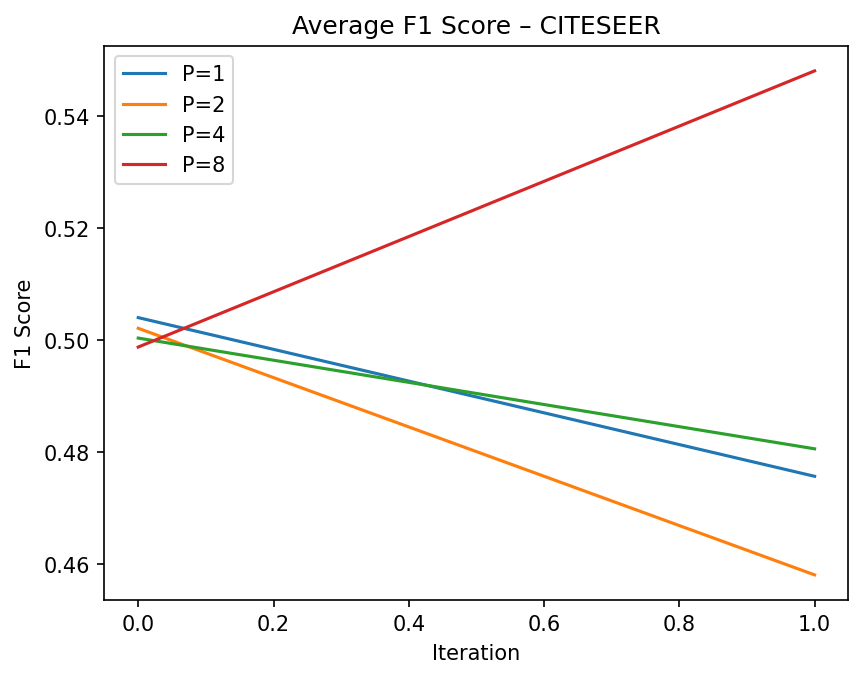

# VertexVoyage

**Distributed and streaming graph vertex embedding with community-aware partitioning.**
Master's thesis project, Department of Mathematics and Informatics, Faculty
of Sciences, University of Novi Sad. Mentor: prof. dr Miloš Savić.

A graph too large for one machine, possibly still growing, is split into $P$
partitions. Each partition is embedded independently with
node2vec / dynnode2vec, and the partition embeddings are merged into one
embedding per vertex. The project asks **when, and why, partitioning
preserves embedding quality**. Quality is measured by graph-reconstruction F1
and by downstream link prediction, as a function of the number of partitions,
the partitioner, the stream settings and the way partition embeddings are
merged.

| | |
|---|---|
| **Status** | Ablation study running ([E11](results/E11-ablation/README.md)); partition alignment ongoing ([E10](results/E10-partition-alignment/README.md)) |
| **Next milestone** | Seeded re-runs of the core results and comparison with LDG / FENNEL ([ROADMAP](ROADMAP.md)) |
| **Last updated** | 2026-11-16 · [progress journal](JOURNAL.md) |

## Research questions and current answers

| RQ | Question | Current answer | Evidence |
|---|---|---|---|
| RQ1 | Does community-aware partitioning preserve reconstruction quality? | It does not collapse it, unlike random partitioning. Cross-partition edges are never reconstructed, though, so F1 changes with $P$ reflect within-partition recall. | [E03](results/E03-partition-scaling/README.md), [E08](results/E08-f1-decomposition/README.md) |
| RQ2 | What are the streaming partitioner's trade-offs? | $\mu = 1$ and buffer 1000 balance partitions ($B \le 1.3$ at $P = 2$ on 4 of 5 datasets) at acceptable F1 cost. | [E02](results/E02-hyperparameters/README.md), [E04](results/E04-balance-penalty/README.md), [E05](results/E05-repartitioning/README.md) |
| RQ3 | Are partitioned embeddings useful for link prediction? | Yes with a random-forest decoder. Neural decoders lose 39–60% MRR from $P = 1$ to 8. | [E09](results/E09-link-prediction/README.md) |
| RQ4 | Can partition spaces be aligned? | A triplet-trained residual aligner recovers cross-partition ranking to 6–14× chance. Theory proved in Lean. | [E10](results/E10-partition-alignment/README.md) |
| RQ5 | Which pipeline components matter? | Exploratory: the structural partitioner is essential. The seeded 19-variant grid is running. | [E11](results/E11-ablation/README.md) |
| RQ6–7 | Comparison with LDG / FENNEL; other embedders such as GraphSAGE | planned | [ROADMAP](ROADMAP.md) |

All experiments are listed in the [experiment registry](results/README.md).

## Headline result: reconstruction F1 vs number of partitions

Streaming pipeline (dynnode2vec, `neighbors.all` partitioner, $\mu = 1$,
buffer 1000, $RF = 1$). Values are the final F1, mean ± std over 3–11 runs
([E03](results/E03-partition-scaling/README.md)). The edge-cut ratio is in
parentheses. The full-graph node2vec baseline is from
[E01](results/E01-static-node2vec/README.md).

| Dataset | node2vec, full graph | $P = 1$ | $P = 2$ | $P = 4$ | $P = 8$ |
|---|---|---|---|---|---|
| CITESEER | 34.8% | 47.6 ± 1.6% | 45.8 ± 0.6% (23%) | 48.1 ± 0.5% (39%) | 54.8 ± 1.7% (48%) |
| DBLP | 60.3% | 50.9 ± 0.3% | 54.1 ± 0.2% (32%) | 54.5 ± 0.2% (50%) | 49.9 ± 0.2% (59%) |
| AstroPh | 70.4% | 57.7 ± 0.1% | 54.7 ± 0.4% (35%) | 51.0 ± 0.5% (56%) | 45.9 ± 0.5% (65%) |
| AS-Oregon | 31.3% | 26.2 ± 0.6% | 24.9 ± 2.7% (30%) | 24.3 ± 1.0% (54%) | 21.5 ± 1.2% (72%) |
| Enron | 20.4% | 18.0 ± 0.4% | 24.8 ± 0.4% (33%) | 27.4 ± 2.8% (49%) | 32.4 ± 1.2% (62%) |



**How to read this table.**
- F1 rising with $P$ (CITESEER, Enron) is **not** a quality gain. In every
  run no cross-partition edge is reconstructed, so recall is capped at
  $1 - \delta$. A rise comes from denser within-partition reconstruction
  ([E08](results/E08-f1-decomposition/README.md), proved in Lean).
- These runs predate the fixed-seed protocol and are scheduled for re-running
  with 10 seeds ([ROADMAP](ROADMAP.md)).
- The full-graph baseline and the streaming $P = 1$ column come from
  different pipelines and settings ([E01 open issues](results/E01-static-node2vec/README.md)).

## Timeline

| Period | Milestone | Artefacts |
|---|---|---|
| 2023-11 → 2024-01 | Literature review and thesis proposal | [proposal](doc/proposal.tex), [application form](official/) |
| 2024-07 → 2025-05 | Distributed system (ZooKeeper, XML-RPC), modified LFM partitioner, partitioned node2vec | [E00](results/E00-legacy-distributed/README.md), [cluster guide](doc/guide/cluster.md) |
| 2025-05 → 2025-11 | LPA vs LFM, DistGER, Seminars 1 and 2 | [Seminar 1](doc/Seminar1/paper.md), [Seminar 2](doc/Seminar2/paper.md) |
| 2026-04 → 2026-09 | Streaming pipeline: dynnode2vec, neighbour partitioner, tuning, $\mu$, buffer size, repartitioning | [E02](results/E02-hyperparameters/README.md)–[E07](results/E07-buffer-size/README.md) |
| 2026-05 → 2026-10 | Link prediction (480 runs), F1 decomposition theory | [E09](results/E09-link-prediction/README.md), [E08](results/E08-f1-decomposition/README.md) |
| 2026-10 → 2026-11 | Partition alignment and its theory (Theorems 1–18 in Lean) | [E10](results/E10-partition-alignment/README.md), [theory](doc/theory/README.md) |
| 2026-11 → | Seeded ablation study on SLURM | [E11](results/E11-ablation/README.md) |
| next | LDG / FENNEL, GraphSAGE, publication | [ROADMAP](ROADMAP.md) |

## Repository map

| Path | Content |
|---|---|
| [`results/`](results/README.md) | One page per experiment: question, setup, results, conclusion, open issues |
| [`doc/`](doc/README.md) | Methods, metrics, datasets, theory, glossary, guides, papers |
| [`proofs/`](proofs/README.md) | Lean 4 / Mathlib proofs of every stated theorem |
| [`vertex_voyage/`](vertex_voyage/) | The library: partitioning, embedding, aggregation, evaluation, CLI (`vv`) |
| [`vertex_voyage_native/`](vertex_voyage_native/) | Rust extension (fast reconstruction) |
| [`experiments/`](experiments/) | Dataset registry and the [ablation runner](experiments/ablation/README.md) |
| [`notebooks/`](notebooks/) | Analysis notebooks that produced the tables and figures |
| [`scripts/`](scripts/) | Experiment, analysis and SLURM scripts |

## Quick start

```bash
conda create -n myenv -c conda-forge rust python=3.9 && conda activate myenv
pip install -r requirements.txt
(cd vertex_voyage_native && maturin develop)
vv temporal_test --name CITESEER --long-run --use-dataset-params \
  --buffer-size 1000 --partitions 4 --partitioner-name neighbors.all \
  --mu 1 --seed 42 --iterations 1
```

More guides:
- [Installation](doc/guide/install.md)
- [Experiment CLI](doc/guide/cli.md)
- [SLURM](doc/guide/slurm.md)
- [Running a cluster](doc/guide/cluster.md)
- [XML-RPC API](doc/guide/xmlrpc.md)
- [Benchmarks](doc/guide/benchmarks.md)
- [Seeding and reproducibility](doc/guide/seeding.md)

## Reports and papers

- Thesis proposal (Serbian): [`doc/proposal.tex`](doc/proposal.tex)
- Seminar 1, *Evaluation and analysis of graph vertex embeddings in
  distributed environment with community-aware vertex partitioning*:
  [paper](doc/Seminar1/paper.md), [slides](doc/Seminar1/presentation/presentation.tex)
- Seminar 2, *… based on information-oriented random walks …*:
  [paper](doc/Seminar2/paper.md), [slides](doc/Seminar2/presentation/presentation.tex)
- Thesis draft: [`doc/Rad.odt`](doc/Rad.odt)

## Citing

```bibtex
@mastersthesis{nozinic_vertexvoyage,
  author = {Stefan No{\v z}ini{\'c}},
  title  = {VertexVoyage: Distributed and Streaming Graph Vertex Embedding with Community-Aware Partitioning},
  school = {University of Novi Sad, Faculty of Sciences},
  note   = {In progress. \url{https://github.com/fantastic001/vertexvoyage}}
}
```
