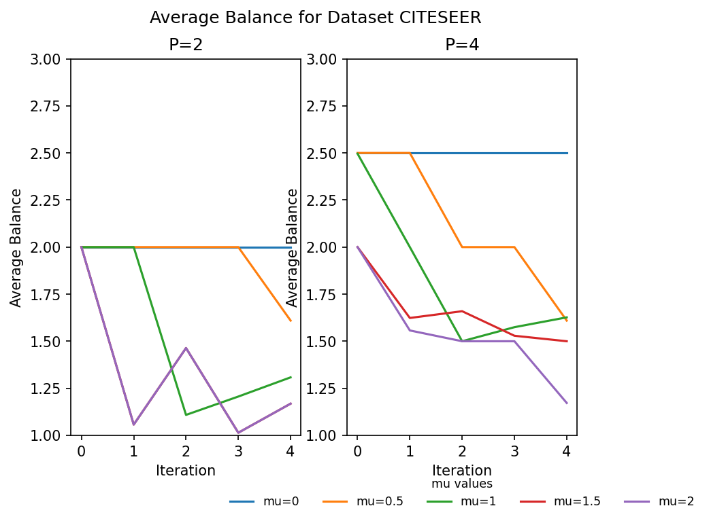
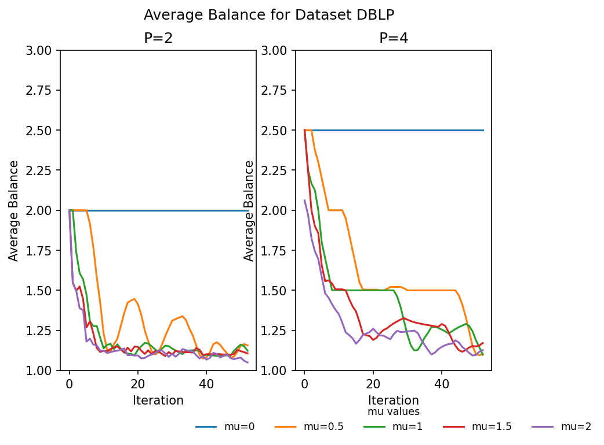
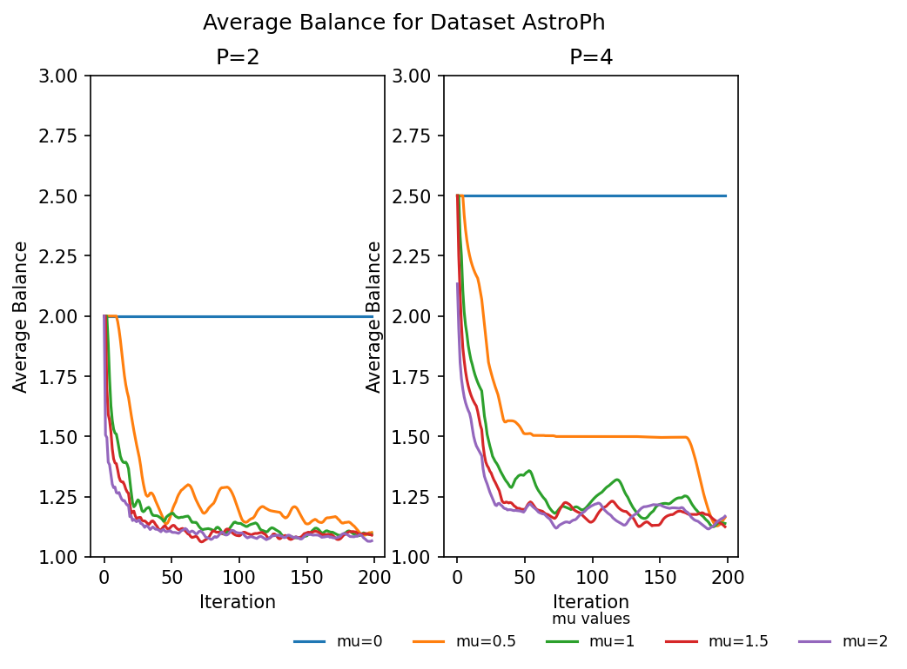
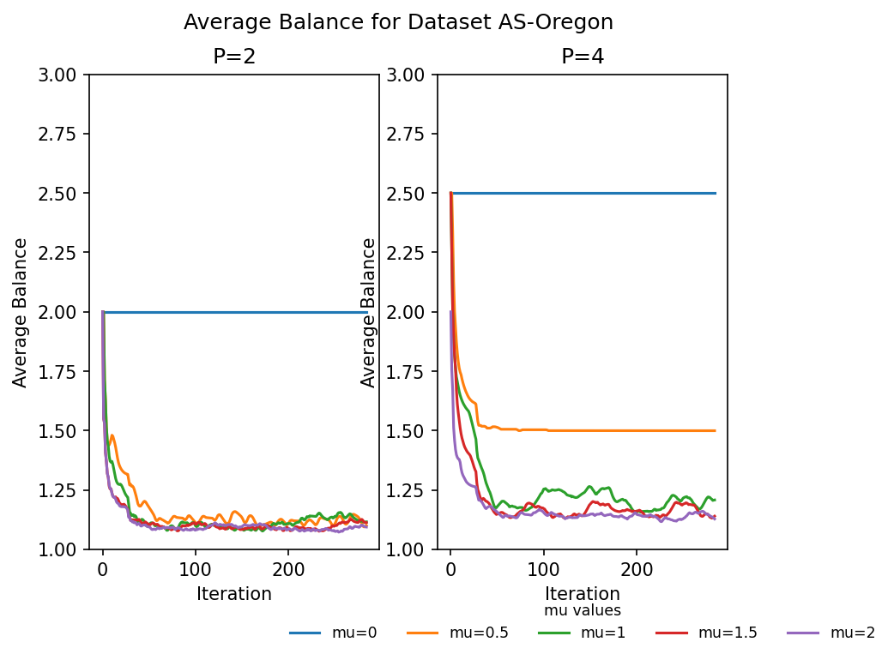
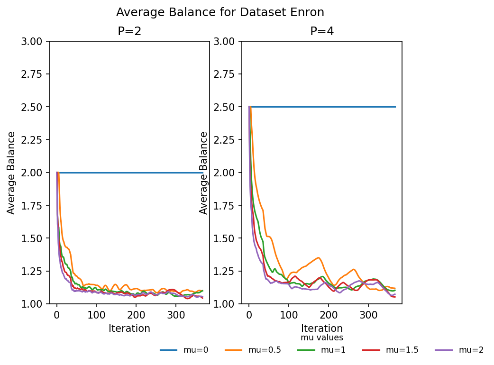

# E04 — Balance-penalty ($\mu$) sensitivity

| | |
|---|---|
| **Research question** | [RQ2](../README.md#research-questions) |
| **Status** | ✅ done · 🔁 re-run with fixed seeds planned |
| **Period** | 2026-08 → 2026-09 |
| **Pipeline** | T, streaming, `--algorithm dummy` for balance (independent of the embedding), dynnode2vec for F1 ([E02](../E02-hyperparameters/README.md)) |
| **Datasets** | CITESEER, DBLP, AstroPh, AS-Oregon, Enron |
| **Headline** | $\mu = 0$ puts every vertex in one partition ($B = 3 - 2/P$, the proven maximum). $\mu = 1$ gives $B \le 1.3$ on 4 of 5 datasets at $P = 2$; beyond $\mu \approx 1$, balance improves little while F1 drops at high $P$. $\mu = 1$ is the chosen operating point. |
| **Open issues** | 3 runs per cell without fixed seeds. |

**Question.** How does the balance-penalty parameter $\mu$ trade off
partition **balance** against embedding quality? The streaming partitioner
adds a term $\mu \cdot (\text{imbalance})$ to its assignment score, so larger
$\mu$ should push partitions toward equal size at the cost of respecting
graph structure less.

**Balance metric.** `get_partition_average_balance(sizes, P)` — the average
deviation of partition sizes from the ideal equal size; **lower is better**,
1.0 is perfect balance.

# How the experiment was run

```bash
for RF in 1; do
 for dataset in CITESEER AstroPh AS-Oregon DBLP Enron; do
  for P in 1 2 4 8; do
   for mu in 0 0.5 1 1.5 2; do
    vv temporal_test --name "$dataset" --long-run --iterations 3 \
       --use-dataset-params --buffer-size 1000 --replication-factor "$RF" \
       --partitioner neighbors.all --mu "$mu" --algorithm dummy --epochs 10 \
       --partitions "$P" \
       --checkpoint "temporal_runs/mu-vary/$dataset-${P}_$mu" \
       --skip-full-graph-baseline
   done
  done
 done
done
```

| Parameter | Value |
|---|---|
| Balance penalty $\mu$ | 0, 0.5, 1, 1.5, 2 |
| Partitions $P$ | 1, 2, 4, 8 |
| $RF$ | 1 |
| Buffer size | 1000 |
| Partitioner | `neighbors.all` |
| Epochs | 10 |
| Iterations (repeats) | 3 |

**Analysis:** [`notebooks/analyze_results.ipynb`](../../notebooks/analyze_results.ipynb)
(`add_to_everything("mu-vary", param_type=float)`). It builds, per dataset,
pivot tables of *balance at the last iteration* and *average balance over
iterations* indexed by $\mu \times P$, and rolling-mean plots of balance vs.
iteration for each $\mu$ (saved to `plots/<dataset>-balance-mu.png`,
y-axis clipped to $[1, 3]$).

# Results

- $\mu = 0$: the partitioner ignores balance; reconstruction F1 is flat
  across $P$ (e.g. AstroPh / CITESEER stay at the $P=1$ value ~0.57 / ~0.58)
  because unbalanced partitions leave most of the graph in one part.
- Increasing $\mu$ tightens balance (the last-iteration balance value drops
  toward 1) but reconstruction F1 becomes sensitive to $P$: on CITESEER F1
  drops to ~0.42–0.49, on AstroPh it falls further at high $P$
  (e.g. $P=8$, $\mu=0.5$: ~0.34). Raw F1 vs. $\mu$ numbers are in
  [hyperparameter tuning](../E02-hyperparameters/README.md).
- The effect grows with $P$: at $P=2$ the balance/quality tension is mild, at
  $P=8$ a large $\mu$ noticeably costs F1.

# Conclusion

$\mu$ is a genuine trade-off knob: $\mu = 0$ gives the best F1 but useless
(unbalanced) partitions; large $\mu$ gives even partitions but fragments the
structure the embedding needs. **$\mu = 1$** is the chosen operating point —
near-balanced partitions with an acceptable F1 cost — and is what the other
experiments and the [main hyperparameter set](../E02-hyperparameters/README.md)
use. The knock-on cost of large $\mu$ on how many vertices get moved is
covered in [repartitioning metrics](../E05-repartitioning/README.md).

# Balance tables and plots

The most common neighbor partitioner (see [methods](../../doc/methods.md#streaming-neighbour-partitioner)) uses a capacity penalty coefficient $\mu$ to discourage assigning vertices to partitions that are already larger than average. This section analyzes the effect of $\mu$ on partition balance, varying $\mu \in \{0, 0.5, 1, 1.5, 2\}$ across all five datasets with 2 and 4 partitions. $\mu = 0$ disables the penalty entirely, so balance is determined purely by neighbor counts; higher $\mu$ increasingly rebalances vertex placement at the expense of prioritizing neighbor locality.

### Balance at the last iteration

The tables below show the average balance at the final iteration for each combination of $\mu$ and partition count. As defined in [evaluation.md](../../doc/evaluation.md#2-partition-quality), $B = 1$ is a perfectly balanced partitioning; higher values indicate greater imbalance.

AS-Oregon:

| μ | P=2 | P=4 |
|---|-----|-----|
| 0.0 | 2.00 | 2.50 |
| 0.5 | 1.18 | 1.49 |
| 1.0 | 1.18 | 1.20 |
| 1.5 | 1.10 | 1.21 |
| 2.0 | 1.05 | 1.19 |

AstroPh:

| μ | P=2 | P=4 |
|---|-----|-----|
| 0.0 | 2.00 | 2.50 |
| 0.5 | 1.15 | 1.18 |
| 1.0 | 1.13 | 1.12 |
| 1.5 | 1.08 | 1.12 |
| 2.0 | 1.05 | 1.22 |

CITESEER:

| μ | P=2 | P=4 |
|---|-----|-----|
| 0.0 | 2.00 | 2.50 |
| 0.5 | 1.61 | 1.61 |
| 1.0 | 1.31 | 1.63 |
| 1.5 | 1.17 | 1.50 |
| 2.0 | 1.17 | 1.17 |

DBLP:

| μ | P=2 | P=4 |
|---|-----|-----|
| 0.0 | 2.00 | 2.50 |
| 0.5 | 1.08 | 1.16 |
| 1.0 | 1.03 | 1.09 |
| 1.5 | 1.14 | 1.20 |
| 2.0 | 1.01 | 1.14 |

Enron:

| μ | P=2 | P=4 |
|---|-----|-----|
| 0.0 | 2.00 | 2.50 |
| 0.5 | 1.10 | 1.14 |
| 1.0 | 1.10 | 1.10 |
| 1.5 | 1.02 | 1.02 |
| 2.0 | 1.06 | 1.06 |

### Average balance across iterations

The tables below show the average balance across all iterations (not just the last one) for each combination of $\mu$ and partition count, capturing how balance behaves during the stream rather than only at the end.

AS-Oregon:

| μ | P=2 | P=4 |
|---|-----|-----|
| 0.0 | 2.00 | 2.50 |
| 0.5 | 1.14 | 1.51 |
| 1.0 | 1.12 | 1.23 |
| 1.5 | 1.10 | 1.18 |
| 2.0 | 1.10 | 1.15 |

AstroPh:

| μ | P=2 | P=4 |
|---|-----|-----|
| 0.0 | 2.00 | 2.50 |
| 0.5 | 1.24 | 1.51 |
| 1.0 | 1.14 | 1.27 |
| 1.5 | 1.11 | 1.21 |
| 2.0 | 1.10 | 1.20 |

CITESEER:

| μ | P=2 | P=4 |
|---|-----|-----|
| 0.0 | 2.00 | 2.50 |
| 0.5 | 1.92 | 2.12 |
| 1.0 | 1.52 | 1.84 |
| 1.5 | 1.34 | 1.66 |
| 2.0 | 1.34 | 1.55 |

DBLP:

| μ | P=2 | P=4 |
|---|-----|-----|
| 0.0 | 2.00 | 2.50 |
| 0.5 | 1.30 | 1.60 |
| 1.0 | 1.17 | 1.40 |
| 1.5 | 1.15 | 1.33 |
| 2.0 | 1.12 | 1.25 |

Enron:

| μ | P=2 | P=4 |
|---|-----|-----|
| 0.0 | 2.00 | 2.50 |
| 0.5 | 1.14 | 1.27 |
| 1.0 | 1.11 | 1.19 |
| 1.5 | 1.09 | 1.17 |
| 2.0 | 1.08 | 1.15 |

### Balance evolution across μ values

The following plots show the (smoothed) average balance over iterations for each $\mu$ value, for P=2 and P=4 partitions side by side.


 




 





Across all datasets, $\mu = 0$ (no capacity penalty) produces the worst balance, exactly the proven maximum $B = 3 - 2/P$ (2.00 at $P = 2$, 2.50 at $P = 4$; [evaluation.md](../../doc/evaluation.md#2-partition-quality)). Every vertex lands in one partition, because vertices are placed purely by neighbour affinity with no regard for partition size. Increasing $\mu$ from 0 to 1 yields the largest balance improvement; beyond $\mu = 1$–$1.5$, returns diminish and balance mostly plateaus, with CITESEER remaining the hardest dataset to balance at every $\mu$ value tested.


