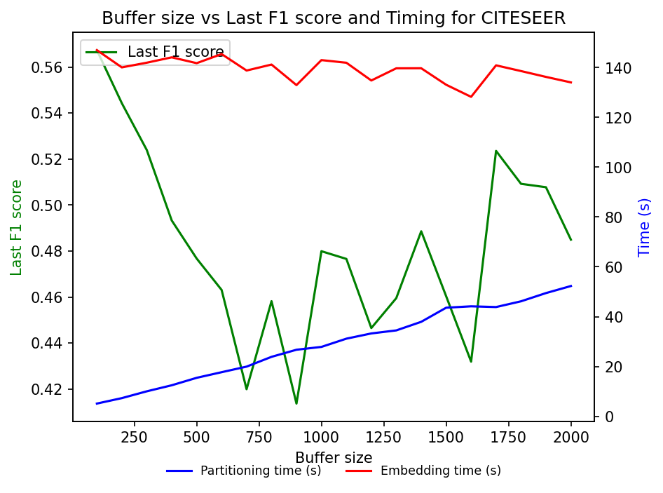
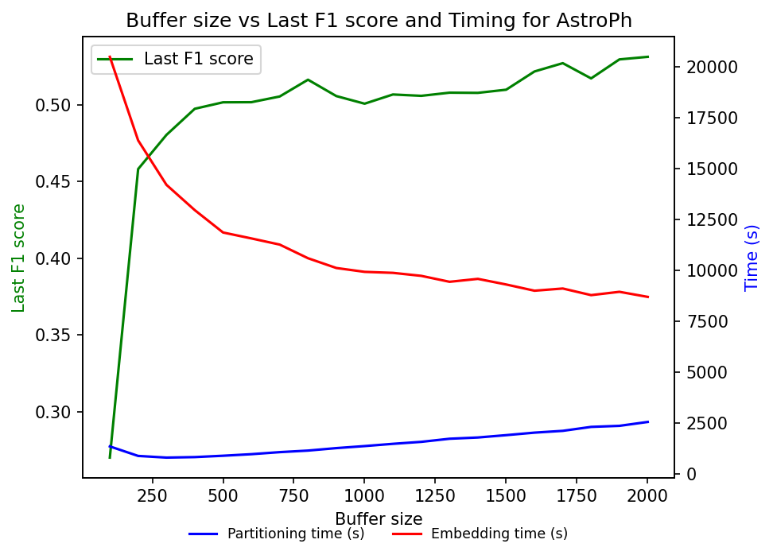

# E07 — Buffer size

| | |
|---|---|
| **Research question** | [RQ2](../README.md#research-questions) |
| **Status** | 🟡 partial: AstroPh sweep at $P = 1$ (single runs) and a CITESEER timing plot; the extremes are covered by the ablation variants `unit_buffer` and `single_buffer` ([E11](../E11-ablation/README.md#stream-buffering)) |
| **Period** | 2026-05 → 2026-09 |
| **Pipeline** | T, streaming, $P = 1$ |
| **Datasets** | AstroPh, CITESEER |
| **Headline** | Very small buffers fail: buffer 100 gives F1 ≈ 1% on AstroPh, because each buffer adds too few edges for the walks to learn from. F1 rises with buffer size (46–57% at 1000, 63% at 10000); 1000 was chosen as the quality/runtime trade-off ([E02](../E02-hyperparameters/README.md)). |
| **Open issues** | Single runs without seeds; no sweep at $P > 1$; the timing plot is not explained in text. |

**Question.** How does the number of events per buffer affect the final
reconstruction F1 and the runtime of the streaming pipeline?

# How it was run

```sh
vv temporal_test --name AstroPh --long-run --iterations 1 --use-dataset-params \
  --buffer-size B --partitions 1 --replication-factor 1 --partitioner-name neighbors.all
```

with $B \in \{100, 1000, 2000, 10000\}$. "Existing nodes" means walks are
started from every affected vertex, including vertices seen before the
current buffer. This is the `neighbors.all` behaviour that later became the
default.

# Results

AstroPh, $P = 1$, final reconstruction F1 and wall-clock time (single runs,
from the [E02](../E02-hyperparameters/README.md#results) log):

| Buffer size | Without existing nodes | With existing nodes |
|---:|---|---|
| 100 | 1% (≈1 h) | 0.8% (≈2 h) |
| 1000 | 46% (≈30 min) | 57% (≈2 h) |
| 2000 | 46% (≈20 min, no per-buffer F1) | — |
| 10000 | 63% (≈1 h, no per-buffer F1) | 63% (≈1 h) |

Static node2vec on the full AstroPh graph reaches 72% in about 5 minutes
([E02](../E02-hyperparameters/README.md#results)).

## Timing





The plots were produced by `notebooks/analyze_results.ipynb`. Their
interpretation still has to be written.

# Conclusion

Buffer size controls a trade-off. Small buffers update the embedding often
but on too little new structure; large buffers approach static training.
1000 events per buffer keeps F1 within about 6 points of the 10000-event
setting for AstroPh at $P = 1$. Re-running with seeds and at $P > 1$ is in
the [ROADMAP](../../ROADMAP.md).
