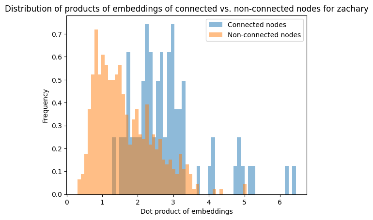
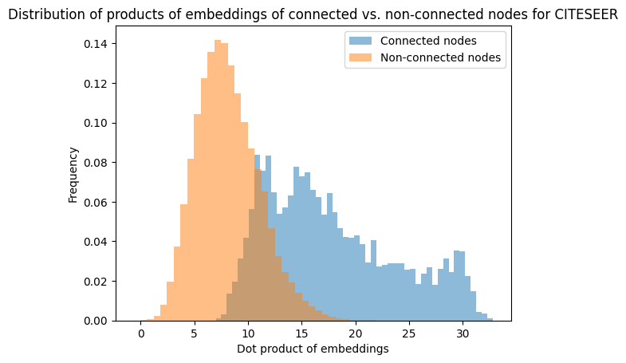
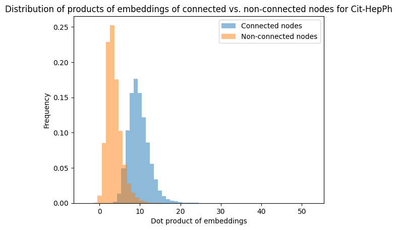
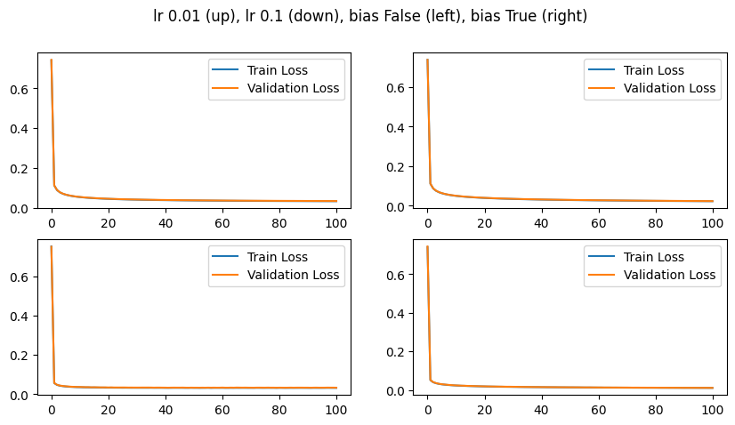
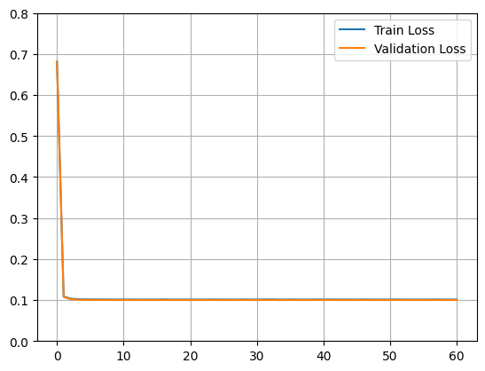
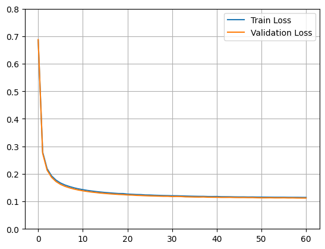
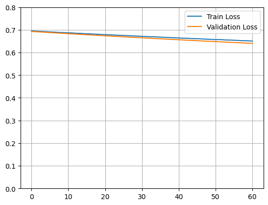

# E09 — Link prediction with partitioned embeddings

| | |
|---|---|
| **Research question** | [RQ3](../README.md#research-questions) |
| **Status** | ✅ done (480 runs) |
| **Period** | 2026-05-26 → 2026-10-12 |
| **Pipeline** | S, static (`vv test --use-lpa --link-prediction-model …`), $P \in \{1,2,4,8\}$, 10 runs per cell |
| **Datasets** | CITESEER, AstroPh, Cit-HepPh, AS-Oregon |
| **Headline** | Ranking of decoders: random forest on $[z_u; z_v]$ > bilinear $\sigma(z_u^\top W z_v)$ > hadamard. From $P = 1$ to $P = 8$, MRR of the neural decoders drops 39–60% (bilinear), while the random forest changes by +4% to −26%. LPA beats LFM. Bilinear wins only at $P = 1$ on dense graphs. |
| **Open issues** | Decoders were not tuned per $P$. Random-forest MRR depends on tie handling. Embeddings were not aligned; the alignment work is [E10](../E10-partition-alignment/README.md). |

**Question.** How well do the partitioned embeddings support the downstream
**link-prediction** task, and how does that depend on the decoder
architecture ($w\cdot(x\odot y)$ vs $x^\top W y$ vs $(x-y)^\top W (x-y)$),
the classifier family (neural net vs random forest), and the partitioning
strategy (LFM vs LPA)? Protocol: remove 20 % of edges, embed the rest, train
on training-graph edges, test on the held-out edges (accuracy, Hits@k, MRR),
alongside the RESTORE F1.

# Contents

- [Contents](#contents)
- [Running experiments](#running-experiments)
- [Link distribution per dimension](#link-distribution-per-dimension)
- [Datasets](#datasets)
- [Evaluations on networks](#evaluations-on-networks)
  - [Analysis of the results](#analysis-of-the-results)
- [Preliminary Results](#preliminary-results)
  - [Experiments with CITESEER](#experiments-with-citeseer)
  - [Experiments with Cit-HepPh](#experiments-with-cit-hepph)
  - [Experiments with full model and average of partitions embeddings](#experiments-with-full-model-and-average-of-partitions-embeddings)
  - [Impact of partitioning strategy on link prediction performance](#impact-of-partitioning-strategy-on-link-prediction-performance)
  - [Different link prediction architectures](#different-link-prediction-architectures)
- [Results](#results)
  - [Hits scores](#hits-scores)
- [Multi-decoder statistical summary (480 runs)](#multi-decoder-statistical-summary-480-runs)
  - [Bilinear decoder](#bilinear-decoder)
    - [Per-metric summary tables](#per-metric-summary-tables)
    - [Correlation between reconstruction F1 and MRR](#correlation-between-reconstruction-f1-and-mrr)
    - [Significance of partitioning on MRR](#significance-of-partitioning-on-mrr)
  - [Hadamard decoder](#hadamard-decoder)
    - [Per-metric summary tables](#per-metric-summary-tables-1)
    - [Correlation between reconstruction F1 and MRR](#correlation-between-reconstruction-f1-and-mrr-1)
    - [Significance of partitioning on MRR](#significance-of-partitioning-on-mrr-1)
  - [Random decision forest (RDF)](#random-decision-forest-rdf)
    - [Per-metric summary tables](#per-metric-summary-tables-2)
    - [Correlation between reconstruction F1 and MRR](#correlation-between-reconstruction-f1-and-mrr-2)
    - [Significance of partitioning on MRR](#significance-of-partitioning-on-mrr-2)
  - [Decoder comparison: bilinear vs hadamard](#decoder-comparison-bilinear-vs-hadamard)
  - [Decoder comparison: bilinear vs RDF](#decoder-comparison-bilinear-vs-rdf)
  - [Decoder comparison: hadamard vs RDF](#decoder-comparison-hadamard-vs-rdf)
- [Simple models evaluation](#simple-models-evaluation)
- [Discussion](#discussion)
- [Conclusion](#conclusion)
- [New experiments](#new-experiments)
  - [Comparing groups for pattern: mrr](#comparing-groups-for-pattern-mrr)
  - [Conclusion](#conclusion-1)


# Running experiments 

```sh
for model in bilinear hadamard random_forest; do mkdir -p lp_eval/$model; for part in 1 2 4 8; do for dataset in CITESEER AstroPh Cit-HepPh AS-Oregon; do for ((i=0; i<10; i++)); do vv test --name $dataset  --break-early  --use-dataset-params --long-run --link-prediction-model $model --use-lpa --partitions $part > lp_eval/$model/$dataset-$part-$i.out; done; done; done; done

```

# Link distribution per dimension 

- We plot $u \odot v$ and check distribution of links per coordinate by plotting CDF. 


# Datasets

- Artificial embedding s.t. there is link between u and v iff $u \odot v > \epsilon$ for some $\epsilon$.
  - $u ~ \mathcal{N}(0, I)$
  - $u ~ \mathcal{U(0, 1)}$
- Zachary 
- CITESEER

# Evaluations on networks

Here is the plot of distribution of dot product of embeddings and wether they are connected:



Same thing for CITESEER:



For Cit-HepPh:



## Analysis of the results

We see that $p(\text{connected} | x \cdot y) = \mathbb{N}(\mu, \sigma)$ where $x$ and $y$ are the embeddings of two nodes 
and $x \cdot y$ is the dot product of the embeddings, is normally distributed with mean $\mu$ and standard deviation $\sigma$.

Given that, we can conclude that the dot product of the embeddings of two nodes is a good predictor of whether they are connected or not.

For this purpose, for link prediction, we can use a simple linear model that takes the dot product of the embeddings as input and outputs a probability of connection.

$$ p(\text{connected} | x \cdot y) = \sigma(w \cdot (x \cdot y) + b) $$

Where $\sigma$ is the sigmoid function, $w$ is the weight and $b$ is the bias.

Sigmoid is used to convert the output of the linear model into a probability between 0 and 1.

We expect that $w$ will be positive, indicating that a higher dot product corresponds to a higher probability of connection, and $b$ will adjust the threshold for predicting a connection.

Essentially, this model will learn to classify pairs of nodes as connected or not based on the dot product of their embeddings, which captures the similarity in the embedding space.

Lets say that we have highest probability of connection at $x \cdot y = 5$, then we can interpret that as the threshold for predicting a connection. If $x \cdot y \to 5$, then $p(\text{connected} | x \cdot y) \to 1$, and if $x \cdot y \to -\infty$, then $p(\text{connected} | x \cdot y) \to 0$.

So here, w and b will be learned parameters that adjust the shape of the sigmoid curve to best fit the observed distribution of connected and non-connected pairs in the embedding space.

# Preliminary Results

When testing with artificial dataset, it is observed that having bias does not contribute much and
that learning rate of 0.1 is sufficient. 



Testing with larger real networks:

```python
train_on_static_graph(citeseer, embedding_model, epochs=60, use_bias=True,  cv_k=1, val_ratio=0.2, learning_rate=0.1)
```

Cit-HepPh:



CITESEER:



Zachary:



## Experiments with CITESEER

Link prediction task implementation:
https://github.com/fantastic001/vertexvoyage/commit/e273f3cf72498206231c507f85334f819f8afc0f

Notebooks:
https://github.com/fantastic001/VertexVoyage/tree/master/notebooks

Results on running on CITESEER with one partition:

    [2026-05-28 23:44:37] New best: p=0.500000, q=0.250000, dim=50, precision=0.606822, recall=0.273664, f1=0.377213
    [2026-05-28 23:44:37] Best achieved F1 score:  0.3772125540320589
    [2026-05-28 23:44:37] Training link prediction model on partition...
    [2026-05-28 23:45:26] Running link prediction...
    True Positives: 435
    False Positives: 42
    True Negatives: 411
    False Negatives: 18
    Precision: 0.9119
    Recall: 0.9603
    F1 Score: 0.9355
    Accuracy: 0.9338
    Acquiring
    Using 12 threads
    [2026-05-28 23:45:28] Global scores: Precision: 0.606822, Recall: 0.273664, F1 Score: 0.377213


With 2 partitions:

    True Positives: 329
    False Positives: 296
    True Negatives: 157
    False Negatives: 124
    Precision: 0.5264
    Recall: 0.7263
    F1 Score: 0.6104
    Accuracy: 0.5364
    Acquiring
    Using 12 threads
    [2026-05-28 23:48:26] Global scores: Precision: 0.583415, Recall: 0.231712, F1 Score: 0.331688

with 4 partitions:

    True Positives: 276
    False Positives: 276
    True Negatives: 177
    False Negatives: 177
    Precision: 0.5000
    Recall: 0.6093
    F1 Score: 0.5493
    Accuracy: 0.5000
    Acquiring
    Using 12 threads
    [2026-05-28 23:50:01] Global scores: Precision: 0.516871, Recall: 0.176256, F1 Score: 0.262871

Link prediction integration with small models for each partition: https://github.com/fantastic001/vertexvoyage/commit/d16d50b1f53d7da3a61e8b50a7b6710b3703b7f3

## Experiments with Cit-HepPh

With 1 partition:

    Ensemble - True Positives: 37272
    Ensemble - False Positives: 1583
    Ensemble - True Negatives: 40508
    Ensemble - False Negatives: 4821
    Ensemble - Precision: 0.9593
    Ensemble - Recall: 0.8855
    Ensemble - F1 Score: 0.9209
    Ensemble - Accuracy: 0.9239

## Experiments with full model and average of partitions embeddings

When training on CITESEER full model - cca 50-60% for accuracy for P 2 4 8

Validation loss and training loss are high and saturate on high value when P = 8

Changing bathsize, epoch number, learning rate did not improve training nor validation loss.

Checking if it can predict links which are connecting partitions:
Result: Now training and validation loss drop to 0.1 which is good. 
True Positives: 0
False Positives: 117
True Negatives: 2083
False Negatives: 2198
Precision: 0.0000
Recall: 0.0000
F1 Score: 0.0000
Accuracy: 0.4736

## Impact of partitioning strategy on link prediction performance

Evaluation on CITESEER:

```
                        LP      F1 restore
walks = nw
without lpa, P=2        68%     30%
with lpa, P=2           81%     46%
with lpa, P=4           71%     48%
with lpa, P=8           71%     55%

```

T run evaluation:
```

for ((i=0; i<10; i++)); do vv test --name CITESEER --break-early  --use-dataset-params --long-run --link-prediction --partitions 2 > e/$i.out; done
cat e/*.out | grep "Full Model - Accuracy" | awk '{val[NR]=$NF; sum+=$NF} END {if (NR>0) {avg=sum/NR; for(i=1; i<=NR; i++) sq_diff+=(val[i]-avg)^2; stddev=sqrt(sq_diff/NR); print "Average:", avg; print "Std Dev:", stddev}}'
cat e/*.out | grep "Global scores: " | awk '{val[NR]=$NF; sum+=$NF} END {if (NR>0) {avg=sum/NR; for(i=1; i<=NR; i++) sq_diff+=(val[i]-avg)^2; stddev=sqrt(sq_diff/NR); print "Average:", avg; print "Std Dev:", stddev}}'

```

CITESEER results for different partitioning strategies:

| Strategy | Partitions | LP Accuracy | RESTORE F1 score |
|----------|------------|-------------|------------------|
| P (baseline) | 1 | 0.92086 ± 0.0105474 | 0.378216 ± 0.0110327 |
| LFM | 2 | 0.6884 ± 0.0108607 | 0.315357 ± 0.0121825 |
| LFM | 4 | 0.5576 ± 0.0158938 | 0.26933 ± 0.00869992 |
| LFM | 8 | 0.54006 ± 0.0172973 | 0.209862 ± 0.00654966 |
| LPA | 2 | 0.80264 ± 0.0193429 | 0.451571 ± 0.0360297 |
| LPA | 4 | 0.74845 ± 0.0060571 | 0.481562 ± 0.0128019 |
| LPA | 8 | 0.7128 ± 0.0199993 | 0.540061 ± 0.0107001 |
| LPA | 16 | 0.68743 ± 0.0147565 | 0.626423 ± 0.0133316 |
| LPA | 32 | 0.6765 ± 0.0168974 | 0.701682 ± 0.00489945 |
| LPA | 64 | 0.66811 ± 0.0114299 | 0.692215 ± 0.00471114 |
| LPA | 128 | 0.68876 ± 0.0180403 | 0.656898 ± 0.0140649 |
| LPA | 256 | 0.67913 ± 0.0157061 | 0.629254 ± 0.019927 |

## Different link prediction architectures

We can model prediction accuracy as:

$$ \text{Accuracy} = bs^{\log_2 p} $$

Where $b$ is the base accuracy for one partition, $s$ is the scaling factor that captures how well the model can leverage additional partitions, and $p$ is the number of partitions.

The following table shows values for b and s for CITESEER on different architecture:

| Architecture | Base Accuracy (b) | Scaling Factor (s) |
|--------------|-------------------|--------------------|
| $w \cdot (x \odot y)$ | 0.9            | 0.9          |


Experimental results:

| Architecture | Dataset | P | LP Accuracy | Train Loss | Val Loss |
|--------------|---------|---|-------------|------------|----------|
| xWy | CITESEER | 1 | 0.93819 +- 0.00785703 | 0.10 | 0.19 |
| xWy | CITESEER | 2 | 0.85815 +- 0.0161917 | 0.13 | 0.42 |
| xWy | CITESEER | 4 | 0.81831 +- 0.0139571 | 0.158079 | 0.606155 |
| xWy | CITESEER | 8 | 0.8223 +- 0.00873098 | 0.15 | 0.66 |
| xWy | CITESEER | 16 | 0.78223 +- 0.0180704 | 0.19 | 0.79 |
|--------------|---------|---|-------------|------------|----------|
| xWy | AstroPh | 1 | 0.9889 | - | - |
| xWy | AstroPh | 2 | 0.9460 | - | - |
| xWy | AstroPh | 4 | 0.8988 | - | - |
| xWy | AstroPh | 8 | 0.8898 | - | - |
| xWy | AstroPh | 16 | 0.8583 | - | - |
|--------------|---------|---|-------------|------------|----------|
| (x-y)W(x-y) | CITESEER | 1 | 0.82439 +- 0.0144918 | 0.29 | 0.45 |
| (x-y)W(x-y) | CITESEER | 2 | 0.66347 +- 0.0194257 | 0.37 | 0.68 |
|--------------|---------|---|-------------|------------|----------|
| xWy (symmetric training) | CITESEER | 1 | 0.91678 +- 0.0119805 | 0.10 | 0.29 |
| xWy (symmetric training) | CITESEER | 2 | 0.818489 +- 0.0147402 | 0.13 | 0.52 |
|--------------|---------|---|-------------|------------|----------|
| xWy (test with early stoping at threshold 0.45 and LR=0.01) | CITESEER | 1 | 0.94613 +- 0.00727641 | 0.19 | 0.19 |
| xWy (test with early stoping at threshold 0.45 and LR=0.01) | CITESEER | 2 | 0.86523 +- 0.00736329 | 0.31 | 0.34 |
| xWy (test with early stoping at threshold 0.45 and LR=0.01) | CITESEER | 4 | 0.80187 +- 0.0169212 | 0.395937 | 0.44 |
| xWy (test with early stoping at threshold 0.45 and LR=0.01) | CITESEER | 8 | 0.78621 +- 0.0136041 | 0.36 | 0.44 |
| xWy (test with early stoping at threshold 0.45 and LR=0.01) | CITESEER | 16 | 0.77725 +- 0.0120921 | 0.29 | 0.48 |

Note: Symmetric training set did not help

Try with regularized form where W is forced to be symmetric
implemented, checking tests

```python
class QuadraticLogitsNet(nn.Module):
    def __init__(self, vector_dim, use_bias = True):
        super(QuadraticLogitsNet, self).__init__()
        self.fc = nn.Linear(vector_dim, vector_dim, bias=use_bias)
        self.in_features = vector_dim
        # Number of unique elements in a symmetric matrix
        num_params = (self.in_features * (self.in_features + 1)) // 2
        self.triu_weights = nn.Parameter(torch.randn(num_params))
    
    def _get_symmetric_matrix(self):
        # 1. Create an empty square matrix
        device = self.triu_weights.device
        W = torch.zeros(self.in_features, self.in_features, device=device)
        
        # 2. Fill the upper triangular part
        triu_indices = torch.triu_indices(self.in_features, self.in_features)
        W[triu_indices[0], triu_indices[1]] = self.triu_weights
        
        # 3. Mirror it to the lower triangular part
        # Subtracting the diagonal avoids doubling it
        W = W + W.T - torch.diag(torch.diag(W))
        return W

    def forward(self, x, y):
        # x shape: [batch, in_features]
        # y shape: [batch, in_features]
        W = self._get_symmetric_matrix()
        
        # Compute x * W * y^T for each batch element efficiently
        # Output shape: [batch, 1]
        out = torch.sum((x @ W) * y, dim=-1, keepdim=True)
        return out
```

```
Test with CITESEER:
P=1                     0.91955 +- 0.0147645            0.184568                0.358335
P=2                     0.84934 +- 0.0132759            0.253081                0.581224
```

We see that the architecture with $w \cdot (x \odot y)$ performs better than the one with $(x-y)W(x-y)$, which suggests that the Hadamard product captures the interaction between node embeddings more effectively for link prediction in this context.

Also, architecture with $x^T W y$ performs better than the one with $(x-y)^T W (x-y)$, which suggests that the direct interaction between node embeddings is more informative than the difference-based interaction for this task.

Best architecture is the one with $X^T W Y$ which suggests that the direct interaction between node embeddings is more informative than the difference-based interaction for this task, and that having a learnable weight matrix W allows the model to capture more complex relationships between the embeddings, leading to better performance in link prediction.

Regarding the partitioning strategy, we see that the accuracy drops as we increase the number of partitions, which suggests that the model struggles to leverage additional partitions effectively. This could be due to the fact that as we increase the number of partitions, the embeddings become more fragmented and less informative for link prediction, leading to a decrease in performance.

Label propagation seems to help with leveraging additional partitions, as we see that the accuracy is higher for LPA compared to LFM, which suggests that the label propagation helps to mitigate the fragmentation of embeddings across partitions and allows the model to better capture the underlying structure of the graph for link prediction.

# Results

## Hits scores

Test run:

```bash
vv test --name <DATASET> --break-early  --use-dataset-params --long-run --link-prediction --use-lpa --partitions <P>
```

| Partitions  |    Accuracy   |     Hits@5     |     Hits@10| MRR |  F1 restore |
|-------------|---------------|----------------|------------|-----|-------------|
|CITESEER     |               |              |                |       |         |
| 1           |    0.7649     |     0.4040   |       0.4768   | 0.2899| 0.377213|
| 2           |    0.7020     |     0.2737   |       0.3135   | 0.1848| 0.451571|
| 4           |    0.6468     |     0.1876   |       0.2318   | 0.1487| 0.481562|
| 8           |    0.6137     |     0.1589   |       0.1921   | 0.1043| 0.540061|
|AstroPh       |               |              |                |       |        |
| 1           |    0.9597     |     0.8460   |       0.9130   | 0.6913| 0.704129|
| 2           |    0.9188     |     0.7080   |       0.7850   | 0.5390| 0.669298|
| 4           |    0.8919     |     0.5950   |       0.7010   | 0.4396| 0.515684|
| 8           |    0.8601     |     0.5280   |       0.6310   | 0.3782| 0.662393|
|Cit-HepPh    |               |              |                |       |         |
| 1           |    0.9550     |     0.8180   |       0.9020   | 0.6272|         |
| 2           |    0.9119     |     0.5820   |       0.7070   | 0.4363|         |
| 4           |    0.8753     |     0.5040   |       0.6360   | 0.3754|         |
| 8           |    0.8519     |     0.5350   |       0.6320   | 0.3909|         |
|AS-Oregon    |               |              |                |       |         |
| 1           |    0.7726     |     0.3580   |       0.4620   | 0.2568| 0.343722|
| 2           |    0.7642     |     0.2820   |       0.3860   | 0.1808| 0.378207|
| 4           |    0.7468     |     0.2210   |       0.3130   | 0.1500| 0.391593|
| 8           |    0.7348     |     0.2280   |       0.3020   | 0.1550| 0.293453|

# Multi-decoder statistical summary (480 runs)

Computed in `notebooks/lp_eval_analysis.ipynb`, which auto-discovers every
decoder subdirectory under `lp_eval/` and generates the same report for each.
Three decoders have been evaluated: two neural-network decoders, `bilinear`
($x^\top W y$) and `hadamard` ($w \cdot (x \odot y)$), and a non-neural
random decision forest (`random_forest`, RDF; 20 trees on the concatenated
pair $[u, v]$). All use LPA partitioning: 4 datasets × {1, 2, 4, 8}
partitions × 10 iterations = 160 runs each, 480 runs total, each
parsed from a `dataset-partitions-iteration.out` log. `F1` below is the
graph-reconstruction F1 (`Best achieved F1 score` line) from that run's
partitioning search — a per-run value, not an average across runs, and it is
computed *before* the decoder-specific link-prediction model is trained, so
it is expected to be decoder-invariant (confirmed in the
[decoder comparison](#decoder-comparison-bilinear-vs-hadamard) below).

## Bilinear decoder

### Per-metric summary tables

Mean ± stddev across the 10 iterations of each `(dataset, partitions)` cell.

**Hits@1**

| Dataset | P=1 | P=2 | P=4 | P=8 |
|---|---|---|---|---|
| AS-Oregon | 14.99% ± 1.07% | 9.70% ± 1.23% | 7.83% ± 1.13% | 7.57% ± 1.40% |
| AstroPh | 56.79% ± 1.58% | 38.54% ± 1.70% | 32.57% ± 2.29% | 27.68% ± 2.34% |
| CITESEER | 17.70% ± 1.14% | 11.08% ± 1.79% | 8.08% ± 0.99% | 5.76% ± 1.10% |
| Cit-HepPh | 48.38% ± 1.47% | 31.05% ± 2.81% | 27.10% ± 2.54% | 24.90% ± 1.91% |

**Hits@3**

| Dataset | P=1 | P=2 | P=4 | P=8 |
|---|---|---|---|---|
| AS-Oregon | 29.22% ± 1.24% | 21.21% ± 1.34% | 17.64% ± 1.63% | 16.60% ± 2.03% |
| AstroPh | 77.48% ± 1.50% | 58.30% ± 2.02% | 51.70% ± 2.66% | 44.71% ± 3.24% |
| CITESEER | 32.25% ± 2.93% | 19.69% ± 1.80% | 15.54% ± 1.02% | 12.01% ± 1.69% |
| Cit-HepPh | 73.21% ± 1.82% | 51.77% ± 4.09% | 45.33% ± 4.16% | 42.48% ± 2.77% |

**Hits@10**

| Dataset | P=1 | P=2 | P=4 | P=8 |
|---|---|---|---|---|
| AS-Oregon | 45.39% ± 1.44% | 36.97% ± 1.19% | 32.74% ± 3.00% | 31.59% ± 2.28% |
| AstroPh | 89.91% ± 0.78% | 74.46% ± 1.37% | 69.70% ± 1.91% | 63.97% ± 2.55% |
| CITESEER | 47.37% ± 3.50% | 30.71% ± 2.55% | 24.50% ± 1.34% | 20.73% ± 1.73% |
| Cit-HepPh | 89.85% ± 0.56% | 72.40% ± 3.12% | 64.52% ± 2.83% | 60.36% ± 2.20% |

**MRR**

| Dataset | P=1 | P=2 | P=4 | P=8 |
|---|---|---|---|---|
| AS-Oregon | 25.08% ± 0.95% | 18.69% ± 1.05% | 15.96% ± 1.51% | 15.34% ± 1.63% |
| AstroPh | 68.74% ± 1.32% | 51.03% ± 1.55% | 45.19% ± 2.19% | 39.64% ± 2.28% |
| CITESEER | 27.61% ± 1.82% | 17.90% ± 1.80% | 13.80% ± 0.71% | 10.94% ± 1.17% |
| Cit-HepPh | 62.95% ± 1.13% | 44.85% ± 3.05% | 39.60% ± 2.81% | 36.91% ± 2.02% |

**F1 (reconstruction, per-run)**

| Dataset | P=1 | P=2 | P=4 | P=8 |
|---|---|---|---|---|
| AS-Oregon | 33.88% ± 0.28% | 38.88% ± 1.91% | 45.97% ± 3.79% | 43.20% ± 1.78% |
| AstroPh | 70.62% ± 0.08% | 67.76% ± 0.09% | 67.84% ± 0.12% | 67.75% ± 0.11% |
| CITESEER | 35.88% ± 1.46% | 43.92% ± 3.25% | 49.72% ± 2.34% | 55.68% ± 6.12% |
| Cit-HepPh | 54.87% ± 0.06% | 57.41% ± 0.79% | 60.35% ± 2.12% | 61.59% ± 0.87% |

Note the opposite trend between the link-prediction metrics (Hits@k, MRR all
decrease with more partitions) and reconstruction F1 (which mostly *increases*
with more partitions, except for AstroPh which stays flat) — partitioning
hurts the downstream link-prediction task while the RESTORE reconstruction
objective it's optimized for improves or holds steady.

### Correlation between reconstruction F1 and MRR

Spearman rank correlation between `F1` and `MRR`, pooled across all 160 runs
(all datasets/partitions/iterations together, not per-dataset):

$$ \rho = 0.6189, \quad p = 2.7 \times 10^{-18}, \quad n = 160 $$

A moderate-to-strong positive correlation, statistically significant — runs
with higher reconstruction F1 tend to also have higher MRR, even though F1
and MRR move in opposite directions *as a function of partition count* (see
table above). This is consistent with F1 and MRR both being driven by
dataset-level "how learnable is this graph" effects that dominate the
pooled correlation, while the partition-count effect within a dataset pulls
them apart.

### Significance of partitioning on MRR

Mann-Whitney U test + Cohen's d effect size on `MRR`, comparing adjacent
partition counts within each dataset (n=10 runs per group):

| Dataset | Comparison | U | p-value | Cohen's d | Significant (α=0.05) |
|---|---|---|---|---|---|
| AS-Oregon | P=1 vs P=2 | 100.0 | 0.000183 | -6.37 | Yes |
| AS-Oregon | P=2 vs P=4 | 96.0 | 0.000583 | -2.10 | Yes |
| AS-Oregon | P=4 vs P=8 | 61.0 | 0.427355 | -0.39 | No |
| AstroPh | P=1 vs P=2 | 100.0 | 0.000183 | -12.27 | Yes |
| AstroPh | P=2 vs P=4 | 99.0 | 0.000246 | -3.07 | Yes |
| AstroPh | P=4 vs P=8 | 96.0 | 0.000583 | -2.48 | Yes |
| CITESEER | P=1 vs P=2 | 100.0 | 0.000183 | -5.35 | Yes |
| CITESEER | P=2 vs P=4 | 99.0 | 0.000246 | -2.98 | Yes |
| CITESEER | P=4 vs P=8 | 100.0 | 0.000183 | -2.96 | Yes |
| Cit-HepPh | P=1 vs P=2 | 100.0 | 0.000182 | -7.86 | Yes |
| Cit-HepPh | P=2 vs P=4 | 89.0 | 0.003611 | -1.79 | Yes |
| Cit-HepPh | P=4 vs P=8 | 81.0 | 0.021134 | -1.10 | Yes |

MRR drops significantly at almost every partition-count step, across all four
datasets, with large negative effect sizes (Cohen's d well below -0.8 in every
significant case). The lone exception is AS-Oregon's P=4 vs P=8 step, which is
not significant (p=0.43) with a small effect size (d=-0.39) — suggesting MRR
has roughly plateaued for AS-Oregon by P=4.

## Hadamard decoder

### Per-metric summary tables

Mean ± stddev across the 10 iterations of each `(dataset, partitions)` cell.

**Hits@1**

| Dataset | P=1 | P=2 | P=4 | P=8 |
|---|---|---|---|---|
| AS-Oregon | 6.99% ± 1.44% | 4.92% ± 0.73% | 4.08% ± 0.88% | 4.49% ± 0.91% |
| AstroPh | 20.73% ± 3.46% | 16.93% ± 2.98% | 18.53% ± 1.79% | 19.56% ± 2.49% |
| CITESEER | 14.37% ± 2.65% | 8.21% ± 1.77% | 7.64% ± 1.59% | 9.38% ± 1.50% |
| Cit-HepPh | 22.45% ± 2.49% | 17.08% ± 1.24% | 16.08% ± 1.42% | 19.93% ± 1.69% |

**Hits@3**

| Dataset | P=1 | P=2 | P=4 | P=8 |
|---|---|---|---|---|
| AS-Oregon | 15.45% ± 2.20% | 10.43% ± 1.09% | 9.12% ± 1.22% | 10.19% ± 1.17% |
| AstroPh | 36.65% ± 4.97% | 29.82% ± 3.68% | 30.90% ± 1.76% | 32.72% ± 2.94% |
| CITESEER | 25.94% ± 3.57% | 15.56% ± 2.43% | 13.75% ± 1.36% | 15.67% ± 1.49% |
| Cit-HepPh | 43.07% ± 3.61% | 32.01% ± 1.33% | 30.70% ± 1.90% | 37.74% ± 2.51% |

**Hits@10**

| Dataset | P=1 | P=2 | P=4 | P=8 |
|---|---|---|---|---|
| AS-Oregon | 29.62% ± 2.72% | 21.46% ± 1.93% | 18.50% ± 2.07% | 20.43% ± 1.33% |
| AstroPh | 55.58% ± 5.68% | 46.86% ± 4.04% | 47.57% ± 2.19% | 49.85% ± 2.50% |
| CITESEER | 38.96% ± 3.50% | 24.46% ± 2.45% | 21.52% ± 1.72% | 21.39% ± 2.55% |
| Cit-HepPh | 67.77% ± 3.84% | 52.46% ± 1.58% | 50.80% ± 1.67% | 57.23% ± 2.52% |

**MRR**

| Dataset | P=1 | P=2 | P=4 | P=8 |
|---|---|---|---|---|
| AS-Oregon | 14.49% ± 1.68% | 10.48% ± 0.78% | 9.12% ± 1.08% | 9.97% ± 0.86% |
| AstroPh | 32.34% ± 4.13% | 26.84% ± 3.22% | 28.24% ± 1.63% | 29.63% ± 2.50% |
| CITESEER | 22.92% ± 2.80% | 13.88% ± 1.88% | 12.49% ± 1.37% | 13.87% ± 1.66% |
| Cit-HepPh | 37.05% ± 2.79% | 28.38% ± 1.22% | 27.15% ± 1.43% | 32.15% ± 1.98% |

**F1 (reconstruction, per-run)**

| Dataset | P=1 | P=2 | P=4 | P=8 |
|---|---|---|---|---|
| AS-Oregon | 34.19% ± 0.42% | 39.12% ± 1.28% | 46.01% ± 6.14% | 45.10% ± 4.18% |
| AstroPh | 70.59% ± 0.05% | 67.85% ± 0.10% | 67.81% ± 0.09% | 67.79% ± 0.11% |
| CITESEER | 36.20% ± 1.07% | 43.41% ± 3.34% | 50.71% ± 4.03% | 55.04% ± 2.89% |
| Cit-HepPh | 54.89% ± 0.08% | 56.55% ± 0.52% | 59.23% ± 2.37% | 61.48% ± 0.90% |

The `F1` table is nearly identical to the bilinear decoder's (e.g. AstroPh
P=1: 70.59% vs 70.62%; Cit-HepPh P=1: 54.89% vs 54.87%), as expected since F1
is computed during partitioning, before either decoder is trained. Hits@k and
MRR, in contrast, are substantially and consistently lower than bilinear's —
see the [decoder comparison](#decoder-comparison-bilinear-vs-hadamard) below.

### Correlation between reconstruction F1 and MRR

Spearman rank correlation between `F1` and `MRR`, pooled across all 160
hadamard runs:

$$ \rho = 0.6514, \quad p = 1.1 \times 10^{-20}, \quad n = 160 $$

Slightly stronger than bilinear's pooled correlation ($\rho = 0.6189$), but
the same qualitative story: higher reconstruction F1 tends to go with higher
MRR when pooling across datasets, driven by dataset-level learnability rather
than the partition-count effect (which pushes F1 up and MRR down within a
dataset).

### Significance of partitioning on MRR

Mann-Whitney U test + Cohen's d effect size on `MRR`, comparing adjacent
partition counts within each dataset (n=10 runs per group):

| Dataset | Comparison | U | p-value | Cohen's d | Significant (α=0.05) |
|---|---|---|---|---|---|
| AS-Oregon | P=1 vs P=2 | 99.0 | 0.000246 | -3.06 | Yes |
| AS-Oregon | P=2 vs P=4 | 89.0 | 0.003611 | -1.43 | Yes |
| AS-Oregon | P=4 vs P=8 | 26.0 | 0.075662 | 0.86 | No |
| AstroPh | P=1 vs P=2 | 86.0 | 0.007285 | -1.49 | Yes |
| AstroPh | P=2 vs P=4 | 34.5 | 0.256660 | 0.55 | No |
| AstroPh | P=4 vs P=8 | 32.0 | 0.185877 | 0.66 | No |
| CITESEER | P=1 vs P=2 | 98.5 | 0.000282 | -3.79 | Yes |
| CITESEER | P=2 vs P=4 | 74.0 | 0.075552 | -0.84 | No |
| CITESEER | P=4 vs P=8 | 20.0 | 0.025748 | 0.91 | Yes |
| Cit-HepPh | P=1 vs P=2 | 100.0 | 0.000183 | -4.03 | Yes |
| Cit-HepPh | P=2 vs P=4 | 73.0 | 0.088973 | -0.93 | No |
| Cit-HepPh | P=4 vs P=8 | 3.0 | 0.000440 | 2.90 | Yes |

Hadamard shows a qualitatively different pattern from bilinear: MRR still
drops sharply and significantly from P=1 to P=2 everywhere (large negative
Cohen's d), but the P=2 → P=4 → P=8 steps are frequently *not* significant,
and where they are significant at higher partition counts the effect
sometimes *reverses sign* — CITESEER (P=4 vs P=8, d=+0.91) and Cit-HepPh
(P=4 vs P=8, d=+2.90) both show MRR significantly *recovering* at P=8. This
suggests hadamard's link-prediction performance is far less sensitive to
(and partially recovers from) partitioning beyond P=2, unlike bilinear which
degrades monotonically and significantly at nearly every step.

## Random decision forest (RDF)

Random forest classifier (20 trees) on the concatenated embeddings
$[u_1, \dots, u_n, v_1, \dots, v_n]$ — no smoothness assumption on the latent
space, unlike the neural decoders. The ranking benchmark uses the same
protocol as for the neural decoders (`ps=1000` sampled positives, 500
negatives each); an earlier RDF sweep run with `ps=100` was replaced by this
one.

### Per-metric summary tables

Mean ± stddev across the 10 iterations of each `(dataset, partitions)` cell.
**Hits@1**

| Dataset | P=1 | P=2 | P=4 | P=8 |
|---|---|---|---|---|
| AS-Oregon | 38.06% ± 1.60% | 41.44% ± 1.77% | 41.58% ± 1.75% | 40.47% ± 1.08% |
| AstroPh | 54.44% ± 1.42% | 53.86% ± 1.85% | 54.79% ± 1.53% | 53.81% ± 1.38% |
| CITESEER | 23.91% ± 1.43% | 21.55% ± 1.96% | 18.79% ± 1.72% | 18.28% ± 1.61% |
| Cit-HepPh | 40.31% ± 0.92% | 37.57% ± 1.81% | 35.82% ± 1.05% | 35.31% ± 1.32% |

**Hits@3**

| Dataset | P=1 | P=2 | P=4 | P=8 |
|---|---|---|---|---|
| AS-Oregon | 44.35% ± 1.48% | 47.14% ± 1.69% | 46.99% ± 1.70% | 46.25% ± 1.53% |
| AstroPh | 66.61% ± 1.61% | 66.12% ± 2.10% | 66.49% ± 1.64% | 65.79% ± 0.88% |
| CITESEER | 35.70% ± 2.07% | 30.40% ± 2.22% | 26.91% ± 2.05% | 26.14% ± 1.59% |
| Cit-HepPh | 59.91% ± 1.30% | 55.79% ± 1.55% | 53.65% ± 1.59% | 53.51% ± 1.42% |

**Hits@10**

| Dataset | P=1 | P=2 | P=4 | P=8 |
|---|---|---|---|---|
| AS-Oregon | 53.71% ± 1.27% | 55.58% ± 1.82% | 54.53% ± 1.55% | 53.72% ± 1.45% |
| AstroPh | 78.96% ± 1.45% | 77.90% ± 2.41% | 77.85% ± 1.23% | 77.67% ± 0.97% |
| CITESEER | 48.23% ± 2.61% | 39.67% ± 2.87% | 35.59% ± 2.35% | 34.02% ± 2.01% |
| Cit-HepPh | 79.78% ± 1.24% | 74.61% ± 1.66% | 72.98% ± 1.27% | 72.38% ± 1.37% |

**MRR**

| Dataset | P=1 | P=2 | P=4 | P=8 |
|---|---|---|---|---|
| AS-Oregon | 43.26% ± 1.49% | 46.25% ± 1.68% | 46.09% ± 1.69% | 45.13% ± 1.13% |
| AstroPh | 62.73% ± 1.28% | 62.05% ± 1.87% | 62.70% ± 1.40% | 61.95% ± 0.91% |
| CITESEER | 32.27% ± 1.47% | 28.02% ± 2.03% | 24.75% ± 1.77% | 23.99% ± 1.37% |
| Cit-HepPh | 53.23% ± 0.97% | 49.86% ± 1.59% | 47.96% ± 0.75% | 47.55% ± 1.08% |

**F1**

| Dataset | P=1 | P=2 | P=4 | P=8 |
|---|---|---|---|---|
| AS-Oregon | 34.03% ± 0.30% | 38.92% ± 3.10% | 44.79% ± 5.53% | 44.88% ± 5.37% |
| AstroPh | 70.58% ± 0.07% | 67.86% ± 0.14% | 67.83% ± 0.19% | 67.76% ± 0.12% |
| CITESEER | 36.11% ± 1.57% | 42.33% ± 3.85% | 49.48% ± 4.72% | 55.77% ± 3.30% |
| Cit-HepPh | 54.82% ± 0.08% | 57.25% ± 0.76% | 59.11% ± 1.94% | 61.35% ± 0.73% |

Relative change in MRR from P=1 to P=8 per decoder — RDF is the least
affected by partitioning.

| Dataset | Bilinear | Hadamard | RDF |
|---|---|---|---|
| AS-Oregon | -39% | -31% | +4% |
| AstroPh | -42% | -8% | -1% |
| CITESEER | -60% | -39% | -26% |
| Cit-HepPh | -41% | -13% | -11% |

### Correlation between reconstruction F1 and MRR

Spearman rank correlation between `F1` and `MRR`, pooled across all 160
RDF runs:

$$ \rho = 0.7194, \quad p = 8.7 \times 10^{-27}, \quad n = 160 $$

The strongest of the three decoders (bilinear $\rho = 0.6189$, hadamard
$\rho = 0.6514$), but still a dataset-level effect rather than a
partitioning effect.

### Significance of partitioning on MRR

Mann-Whitney U test + Cohen's d on `MRR`, adjacent partition counts within
each dataset (n=10 per group):

| Dataset | Comparison | U | p-value | Cohen's d | Significant (α=0.05) |
|---|---|---|---|---|---|
| AS-Oregon | P=1 vs P=2 | 10.0 | 0.002827 | 1.88 | Yes |
| AS-Oregon | P=2 vs P=4 | 52.0 | 0.909722 | -0.09 | No |
| AS-Oregon | P=4 vs P=8 | 67.0 | 0.212294 | -0.67 | No |
| AstroPh | P=1 vs P=2 | 63.0 | 0.344704 | -0.43 | No |
| AstroPh | P=2 vs P=4 | 39.0 | 0.427355 | 0.40 | No |
| AstroPh | P=4 vs P=8 | 66.0 | 0.241322 | -0.64 | No |
| CITESEER | P=1 vs P=2 | 93.0 | 0.001315 | -2.40 | Yes |
| CITESEER | P=2 vs P=4 | 95.0 | 0.000769 | -1.72 | Yes |
| CITESEER | P=4 vs P=8 | 66.0 | 0.241322 | -0.48 | No |
| Cit-HepPh | P=1 vs P=2 | 97.0 | 0.000440 | -2.55 | Yes |
| Cit-HepPh | P=2 vs P=4 | 87.0 | 0.005795 | -1.52 | Yes |
| Cit-HepPh | P=4 vs P=8 | 58.5 | 0.545199 | -0.44 | No |

5 of 12 steps are significant (bilinear: 11 of 12; hadamard: 7 of 12). The
degradation is confined to CITESEER and Cit-HepPh and to the first steps
(P=1→2→4); no P=4→8 step is significant for any dataset, i.e. MRR plateaus.
AS-Oregon actually *improves* from P=1 to P=2 (d=+1.88), and AstroPh shows no
significant change at any step.

## Decoder comparison: bilinear vs hadamard

For every `(dataset, partitions)` group both decoders have runs for (all 16
combinations, since both sweeps are now complete), Mann-Whitney U +
Cohen's d compare the two decoders directly (n=10 runs per group; positive
Cohen's d means hadamard scored higher, negative means bilinear scored
higher).

**Hits@1**

| Dataset | P | U | p-value | Cohen's d | Significant |
|---|---|---|---|---|---|
| AS-Oregon | 1 | 100.0 | 0.000183 | -6.30 | Yes |
| AS-Oregon | 2 | 100.0 | 0.000181 | -4.72 | Yes |
| AS-Oregon | 4 | 100.0 | 0.000177 | -3.70 | Yes |
| AS-Oregon | 8 | 99.0 | 0.000238 | -2.61 | Yes |
| AstroPh | 1 | 100.0 | 0.000182 | -13.41 | Yes |
| AstroPh | 2 | 100.0 | 0.000181 | -8.90 | Yes |
| AstroPh | 4 | 100.0 | 0.000183 | -6.84 | Yes |
| AstroPh | 8 | 100.0 | 0.000183 | -3.36 | Yes |
| CITESEER | 1 | 88.0 | 0.004420 | -1.63 | Yes |
| CITESEER | 2 | 88.5 | 0.004030 | -1.61 | Yes |
| CITESEER | 4 | 60.0 | 0.471841 | -0.34 | No |
| CITESEER | 8 | 1.0 | 0.000237 | +2.75 | Yes |
| Cit-HepPh | 1 | 100.0 | 0.000181 | -12.69 | Yes |
| Cit-HepPh | 2 | 100.0 | 0.000183 | -6.44 | Yes |
| Cit-HepPh | 4 | 100.0 | 0.000180 | -5.35 | Yes |
| Cit-HepPh | 8 | 98.0 | 0.000328 | -2.75 | Yes |

**Hits@3**

| Dataset | P | U | p-value | Cohen's d | Significant |
|---|---|---|---|---|---|
| AS-Oregon | 1 | 100.0 | 0.000183 | -7.71 | Yes |
| AS-Oregon | 2 | 100.0 | 0.000182 | -8.84 | Yes |
| AS-Oregon | 4 | 100.0 | 0.000182 | -5.93 | Yes |
| AS-Oregon | 8 | 100.0 | 0.000181 | -3.87 | Yes |
| AstroPh | 1 | 100.0 | 0.000182 | -11.12 | Yes |
| AstroPh | 2 | 100.0 | 0.000182 | -9.58 | Yes |
| AstroPh | 4 | 100.0 | 0.000183 | -9.23 | Yes |
| AstroPh | 8 | 100.0 | 0.000183 | -3.88 | Yes |
| CITESEER | 1 | 94.0 | 0.000999 | -1.93 | Yes |
| CITESEER | 2 | 92.5 | 0.001474 | -1.93 | Yes |
| CITESEER | 4 | 84.0 | 0.011024 | -1.49 | Yes |
| CITESEER | 8 | 3.5 | 0.000502 | +2.30 | Yes |
| Cit-HepPh | 1 | 100.0 | 0.000182 | -10.54 | Yes |
| Cit-HepPh | 2 | 100.0 | 0.000182 | -6.50 | Yes |
| Cit-HepPh | 4 | 100.0 | 0.000183 | -4.52 | Yes |
| Cit-HepPh | 8 | 91.0 | 0.002202 | -1.79 | Yes |

**Hits@10**

| Dataset | P | U | p-value | Cohen's d | Significant |
|---|---|---|---|---|---|
| AS-Oregon | 1 | 100.0 | 0.000181 | -7.24 | Yes |
| AS-Oregon | 2 | 100.0 | 0.000181 | -9.69 | Yes |
| AS-Oregon | 4 | 100.0 | 0.000180 | -5.53 | Yes |
| AS-Oregon | 8 | 100.0 | 0.000178 | -5.98 | Yes |
| AstroPh | 1 | 100.0 | 0.000182 | -8.47 | Yes |
| AstroPh | 2 | 100.0 | 0.000179 | -9.16 | Yes |
| AstroPh | 4 | 100.0 | 0.000183 | -10.75 | Yes |
| AstroPh | 8 | 100.0 | 0.000183 | -5.58 | Yes |
| CITESEER | 1 | 97.5 | 0.000375 | -2.40 | Yes |
| CITESEER | 2 | 98.0 | 0.000321 | -2.50 | Yes |
| CITESEER | 4 | 92.0 | 0.001672 | -1.93 | Yes |
| CITESEER | 8 | 42.0 | 0.567529 | +0.30 | No |
| Cit-HepPh | 1 | 100.0 | 0.000181 | -8.04 | Yes |
| Cit-HepPh | 2 | 100.0 | 0.000183 | -8.07 | Yes |
| Cit-HepPh | 4 | 100.0 | 0.000178 | -5.91 | Yes |
| Cit-HepPh | 8 | 83.0 | 0.013947 | -1.32 | Yes |

**MRR**

| Dataset | P | U | p-value | Cohen's d | Significant |
|---|---|---|---|---|---|
| AS-Oregon | 1 | 100.0 | 0.000183 | -7.77 | Yes |
| AS-Oregon | 2 | 100.0 | 0.000183 | -8.86 | Yes |
| AS-Oregon | 4 | 100.0 | 0.000183 | -5.21 | Yes |
| AS-Oregon | 8 | 100.0 | 0.000183 | -4.12 | Yes |
| AstroPh | 1 | 100.0 | 0.000183 | -11.87 | Yes |
| AstroPh | 2 | 100.0 | 0.000183 | -9.57 | Yes |
| AstroPh | 4 | 100.0 | 0.000183 | -8.76 | Yes |
| AstroPh | 8 | 100.0 | 0.000183 | -4.18 | Yes |
| CITESEER | 1 | 97.0 | 0.000440 | -1.99 | Yes |
| CITESEER | 2 | 97.0 | 0.000437 | -2.18 | Yes |
| CITESEER | 4 | 75.0 | 0.064022 | -1.20 | No |
| CITESEER | 8 | 5.0 | 0.000769 | +2.05 | Yes |
| Cit-HepPh | 1 | 100.0 | 0.000182 | -12.17 | Yes |
| Cit-HepPh | 2 | 100.0 | 0.000183 | -7.08 | Yes |
| Cit-HepPh | 4 | 100.0 | 0.000183 | -5.59 | Yes |
| Cit-HepPh | 8 | 95.5 | 0.000667 | -2.38 | Yes |

**F1 (reconstruction, per-run)**

| Dataset | P | U | p-value | Cohen's d | Significant |
|---|---|---|---|---|---|
| AS-Oregon | 1 | 22.0 | 0.037635 | +0.88 | Yes |
| AS-Oregon | 2 | 46.0 | 0.791337 | +0.14 | No |
| AS-Oregon | 4 | 43.0 | 0.623176 | +0.01 | No |
| AS-Oregon | 8 | 37.0 | 0.344704 | +0.59 | No |
| AstroPh | 1 | 70.0 | 0.140465 | -0.41 | No |
| AstroPh | 2 | 29.0 | 0.121225 | +0.93 | No |
| AstroPh | 4 | 58.0 | 0.570750 | -0.20 | No |
| AstroPh | 8 | 40.0 | 0.472676 | +0.29 | No |
| CITESEER | 1 | 46.0 | 0.791337 | +0.25 | No |
| CITESEER | 2 | 48.0 | 0.909722 | -0.16 | No |
| CITESEER | 4 | 47.0 | 0.850107 | +0.30 | No |
| CITESEER | 8 | 60.0 | 0.472676 | -0.13 | No |
| Cit-HepPh | 1 | 48.0 | 0.909722 | +0.17 | No |
| Cit-HepPh | 2 | 82.0 | 0.017257 | -1.29 | Yes |
| Cit-HepPh | 4 | 68.0 | 0.185877 | -0.50 | No |
| Cit-HepPh | 8 | 58.0 | 0.570750 | -0.13 | No |

Two clear findings emerge:

- **Bilinear dominates hadamard on link-prediction accuracy almost
  everywhere.** Across Hits@1/3/10 and MRR, bilinear is significantly
  better than hadamard in 14–15 of 16 `(dataset, partitions)` groups, usually
  with very large effect sizes (|Cohen's d| > 2, often > 5-10). The single
  systematic exception is **CITESEER at P=8**, where hadamard significantly
  *outperforms* bilinear on Hits@1, Hits@3 and MRR (Cohen's d ≈ +2.0 to
  +2.8), though the two are statistically indistinguishable on Hits@10
  (p=0.57). CITESEER at P=4 is also a partial exception: the difference on
  Hits@1 (p=0.47) and MRR (p=0.064) is not significant, even though Hits@3
  and Hits@10 still favor bilinear. This lines up with hadamard's own
  partition-count analysis above, where CITESEER and Cit-HepPh were the two
  datasets showing significant MRR *recovery* at higher partition counts.
- **F1 is decoder-invariant, as expected.** Only 2 of 16 groups show a
  significant F1 difference (AS-Oregon P=1, d=+0.88; Cit-HepPh P=2, d=-1.29),
  both with modest effect sizes and no consistent sign — consistent with
  run-to-run partitioning noise rather than a real effect of decoder choice,
  since F1 is computed before the decoder is ever trained. This is a useful
  sanity check on the pipeline: the decoder only affects the downstream
  link-prediction quality, not the upstream reconstruction quality it's
  built on.

## Decoder comparison: bilinear vs RDF

Same test per `(dataset, partitions)` group (n=10). Cells are Cohen's d
with the RDF as the second group, so **positive = RDF scored higher**;
`*` marks Mann-Whitney p < 0.05.

| Dataset | P | Hits@1 | Hits@3 | Hits@10 | MRR | F1 |
|---|---|---|---|---|---|---|
| AS-Oregon | 1 | +16.94* | +11.09* | +6.12* | +14.52* | +0.52 |
| AS-Oregon | 2 | +20.77* | +17.00* | +12.10* | +19.63* | +0.02 |
| AS-Oregon | 4 | +22.88* | +17.63* | +9.13* | +18.78* | -0.25 |
| AS-Oregon | 8 | +26.31* | +16.46* | +11.58* | +21.24* | +0.42 |
| AstroPh | 1 | -1.57* | -6.97* | -9.43* | -4.62* | -0.53 |
| AstroPh | 2 | +8.63* | +3.80* | +1.75* | +6.42* | +0.87 |
| AstroPh | 4 | +11.42* | +6.69* | +5.07* | +9.52* | -0.04 |
| AstroPh | 8 | +13.59* | +8.88* | +7.09* | +12.83* | +0.06 |
| CITESEER | 1 | +4.78* | +1.36* | +0.28 | +2.81* | +0.15 |
| CITESEER | 2 | +5.57* | +5.29* | +3.31* | +5.28* | -0.44 |
| CITESEER | 4 | +7.63* | +7.02* | +5.80* | +8.11* | -0.06 |
| CITESEER | 8 | +9.09* | +8.61* | +7.09* | +10.26* | +0.02 |
| Cit-HepPh | 1 | -6.60* | -8.40* | -10.49* | -9.24* | -0.79 |
| Cit-HepPh | 2 | +2.76* | +1.30* | +0.89 | +2.06* | -0.20 |
| Cit-HepPh | 4 | +4.49* | +2.64* | +3.86* | +4.07* | -0.61 |
| Cit-HepPh | 8 | +6.33* | +5.01* | +6.56* | +6.57* | -0.30 |

RDF beats bilinear significantly on MRR in 14 of 16 groups, with very large
effects (d up to +21) that grow with the number of partitions. The only
exceptions are P=1 on the two dense datasets (AstroPh d=−4.6, Cit-HepPh
d=−9.2), where bilinear is significantly better. Even Cit-HepPh P=2 now favors
RDF. F1 is decoder-invariant (0 of 16 significant).

## Decoder comparison: hadamard vs RDF

Same layout; positive = RDF scored higher.

| Dataset | P | Hits@1 | Hits@3 | Hits@10 | MRR | F1 |
|---|---|---|---|---|---|---|
| AS-Oregon | 1 | +20.38* | +15.41* | +11.33* | +18.14* | -0.44 |
| AS-Oregon | 2 | +26.91* | +25.85* | +18.19* | +27.23* | -0.08 |
| AS-Oregon | 4 | +27.05* | +25.60* | +19.67* | +26.02* | -0.21 |
| AS-Oregon | 8 | +36.03* | +26.47* | +23.96* | +35.08* | -0.04 |
| AstroPh | 1 | +12.75* | +8.10* | +5.64* | +9.95* | -0.19 |
| AstroPh | 2 | +14.88* | +12.11* | +9.34* | +13.38* | +0.08 |
| AstroPh | 4 | +21.77* | +20.94* | +17.01* | +22.67* | +0.10 |
| AstroPh | 8 | +16.98* | +15.26* | +14.66* | +17.19* | -0.23 |
| CITESEER | 1 | +4.48* | +3.34* | +3.00* | +4.18* | -0.07 |
| CITESEER | 2 | +7.14* | +6.36* | +5.70* | +7.23* | -0.30 |
| CITESEER | 4 | +6.75* | +7.56* | +6.84* | +7.75* | -0.28 |
| CITESEER | 8 | +5.72* | +6.81* | +5.51* | +6.66* | +0.24 |
| Cit-HepPh | 1 | +9.52* | +6.20* | +4.21* | +7.75* | -0.86 |
| Cit-HepPh | 2 | +13.21* | +16.45* | +13.68* | +15.12* | +1.08* |
| Cit-HepPh | 4 | +15.81* | +13.10* | +14.96* | +18.21* | -0.06 |
| Cit-HepPh | 8 | +10.13* | +7.74* | +7.49* | +9.67* | -0.16 |

RDF significantly beats hadamard in **all 16 groups on all four ranking
metrics** (MRR d from +4.2 to +35.1). F1 is again decoder-invariant (1 of 16
significant).

# Simple models evaluation
<div>
<style scoped>
    .dataframe tbody tr th:only-of-type {
        vertical-align: middle;
    }

    .dataframe tbody tr th {
        vertical-align: top;
    }

    .dataframe thead th {
        text-align: right;
    }
</style>
<table border="1" class="dataframe">
  <thead>
    <tr style="text-align: right;">
      <th></th>
      <th>model</th>
      <th>preprocessor</th>
      <th>accuracy</th>
      <th>f1_score</th>
      <th>dataset</th>
      <th>partitions</th>
    </tr>
  </thead>
  <tbody>
    <tr>
      <th>0</th>
      <td>RandomForestClassifier</td>
      <td>Concatenate</td>
      <td>0.786976</td>
      <td>0.740940</td>
      <td>CITESEER</td>
      <td>1</td>
    </tr>
    <tr>
      <th>1</th>
      <td>RandomForestClassifier</td>
      <td>Average</td>
      <td>0.782561</td>
      <td>0.743155</td>
      <td>CITESEER</td>
      <td>1</td>
    </tr>
    <tr>
      <th>2</th>
      <td>SVC</td>
      <td>Concatenate</td>
      <td>0.778146</td>
      <td>0.728745</td>
      <td>CITESEER</td>
      <td>1</td>
    </tr>
    <tr>
      <th>3</th>
      <td>SVC</td>
      <td>Average</td>
      <td>0.774834</td>
      <td>0.726542</td>
      <td>CITESEER</td>
      <td>1</td>
    </tr>
    <tr>
      <th>4</th>
      <td>LogisticRegressionCV</td>
      <td>Hadamard</td>
      <td>0.769316</td>
      <td>0.714870</td>
      <td>CITESEER</td>
      <td>1</td>
    </tr>
    <tr>
      <th>5</th>
      <td>SVC</td>
      <td>Hadamard</td>
      <td>0.767108</td>
      <td>0.711354</td>
      <td>CITESEER</td>
      <td>1</td>
    </tr>
    <tr>
      <th>6</th>
      <td>SVC</td>
      <td>L1</td>
      <td>0.766004</td>
      <td>0.701408</td>
      <td>CITESEER</td>
      <td>1</td>
    </tr>
    <tr>
      <th>7</th>
      <td>SVC</td>
      <td>L2</td>
      <td>0.763797</td>
      <td>0.699438</td>
      <td>CITESEER</td>
      <td>1</td>
    </tr>
    <tr>
      <th>8</th>
      <td>LogisticRegressionCV</td>
      <td>L2</td>
      <td>0.753863</td>
      <td>0.680973</td>
      <td>CITESEER</td>
      <td>1</td>
    </tr>
    <tr>
      <th>9</th>
      <td>LogisticRegressionCV</td>
      <td>L1</td>
      <td>0.749448</td>
      <td>0.672439</td>
      <td>CITESEER</td>
      <td>1</td>
    </tr>
    <tr>
      <th>10</th>
      <td>RandomForestClassifier</td>
      <td>Hadamard</td>
      <td>0.737307</td>
      <td>0.651026</td>
      <td>CITESEER</td>
      <td>1</td>
    </tr>
    <tr>
      <th>11</th>
      <td>RandomForestClassifier</td>
      <td>L1</td>
      <td>0.720751</td>
      <td>0.618401</td>
      <td>CITESEER</td>
      <td>1</td>
    </tr>
    <tr>
      <th>12</th>
      <td>RandomForestClassifier</td>
      <td>L2</td>
      <td>0.720751</td>
      <td>0.618401</td>
      <td>CITESEER</td>
      <td>1</td>
    </tr>
    <tr>
      <th>13</th>
      <td>LogisticRegressionCV</td>
      <td>Average</td>
      <td>0.567329</td>
      <td>0.552511</td>
      <td>CITESEER</td>
      <td>1</td>
    </tr>
    <tr>
      <th>14</th>
      <td>LogisticRegressionCV</td>
      <td>Concatenate</td>
      <td>0.565121</td>
      <td>0.558296</td>
      <td>CITESEER</td>
      <td>1</td>
    </tr>
  </tbody>
</table>
</div>

Results for Random decision forest with 100 estimators and preprocessing defined as follows:

$$ \text{input} = [u_1, ..., u_n, v_1, ..., v_n] $$

Where $u$ and $v$ are the embeddings of the two nodes in the pair.

<div>
<style scoped>
    .dataframe tbody tr th:only-of-type {
        vertical-align: middle;
    }

    .dataframe tbody tr th {
        vertical-align: top;
    }

    .dataframe thead th {
        text-align: right;
    }
</style>
<table border="1" class="dataframe">
  <thead>
    <tr style="text-align: right;">
      <th></th>
      <th>dataset</th>
      <th>partitions</th>
      <th>#1 model</th>
      <th>#1 preprocessor</th>
      <th>#1 accuracy</th>
      <th>#1 f1_score</th>
    </tr>
  </thead>
  <tbody>
    <tr>
      <th>0</th>
      <td>CITESEER</td>
      <td>1</td>
      <td>RandomForestClassifier</td>
      <td>Concatenate</td>
      <td>0.784768</td>
      <td>0.735414</td>
    </tr>
    <tr>
      <th>1</th>
      <td>CITESEER</td>
      <td>2</td>
      <td>RandomForestClassifier</td>
      <td>Concatenate</td>
      <td>0.749448</td>
      <td>0.682517</td>
    </tr>
    <tr>
      <th>2</th>
      <td>CITESEER</td>
      <td>4</td>
      <td>RandomForestClassifier</td>
      <td>Concatenate</td>
      <td>0.735099</td>
      <td>0.658120</td>
    </tr>
    <tr>
      <th>3</th>
      <td>CITESEER</td>
      <td>8</td>
      <td>RandomForestClassifier</td>
      <td>Concatenate</td>
      <td>0.728477</td>
      <td>0.642442</td>
    </tr>
    <tr>
      <th>4</th>
      <td>AstroPh</td>
      <td>1</td>
      <td>RandomForestClassifier</td>
      <td>Concatenate</td>
      <td>0.953410</td>
      <td>0.952435</td>
    </tr>
    <tr>
      <th>5</th>
      <td>AstroPh</td>
      <td>2</td>
      <td>RandomForestClassifier</td>
      <td>Concatenate</td>
      <td>0.950103</td>
      <td>0.949129</td>
    </tr>
    <tr>
      <th>6</th>
      <td>AstroPh</td>
      <td>4</td>
      <td>RandomForestClassifier</td>
      <td>Concatenate</td>
      <td>0.948412</td>
      <td>0.947211</td>
    </tr>
    <tr>
      <th>7</th>
      <td>AstroPh</td>
      <td>8</td>
      <td>RandomForestClassifier</td>
      <td>Concatenate</td>
      <td>0.946192</td>
      <td>0.944898</td>
    </tr>
    <tr>
      <th>8</th>
      <td>Cit-HepPh</td>
      <td>1</td>
      <td>RandomForestClassifier</td>
      <td>Concatenate</td>
      <td>0.953910</td>
      <td>0.953301</td>
    </tr>
    <tr>
      <th>9</th>
      <td>Cit-HepPh</td>
      <td>2</td>
      <td>RandomForestClassifier</td>
      <td>Concatenate</td>
      <td>0.941521</td>
      <td>0.940099</td>
    </tr>
    <tr>
      <th>10</th>
      <td>Cit-HepPh</td>
      <td>4</td>
      <td>RandomForestClassifier</td>
      <td>Concatenate</td>
      <td>0.935641</td>
      <td>0.933870</td>
    </tr>
    <tr>
      <th>11</th>
      <td>Cit-HepPh</td>
      <td>8</td>
      <td>RandomForestClassifier</td>
      <td>Concatenate</td>
      <td>0.934204</td>
      <td>0.932206</td>
    </tr>
    <tr>
      <th>12</th>
      <td>Cit-HepTh</td>
      <td>1</td>
      <td>RandomForestClassifier</td>
      <td>Concatenate</td>
      <td>0.946739</td>
      <td>0.945893</td>
    </tr>
    <tr>
      <th>13</th>
      <td>Cit-HepTh</td>
      <td>2</td>
      <td>RandomForestClassifier</td>
      <td>Concatenate</td>
      <td>0.942410</td>
      <td>0.941516</td>
    </tr>
    <tr>
      <th>14</th>
      <td>Cit-HepTh</td>
      <td>4</td>
      <td>RandomForestClassifier</td>
      <td>Concatenate</td>
      <td>0.941318</td>
      <td>0.940112</td>
    </tr>
    <tr>
      <th>15</th>
      <td>Cit-HepTh</td>
      <td>8</td>
      <td>RandomForestClassifier</td>
      <td>Concatenate</td>
      <td>0.941616</td>
      <td>0.940398</td>
    </tr>
    <tr>
      <th>16</th>
      <td>AS-Oregon</td>
      <td>1</td>
      <td>RandomForestClassifier</td>
      <td>Concatenate</td>
      <td>0.915678</td>
      <td>0.909718</td>
    </tr>
    <tr>
      <th>17</th>
      <td>AS-Oregon</td>
      <td>2</td>
      <td>RandomForestClassifier</td>
      <td>Concatenate</td>
      <td>0.912713</td>
      <td>0.906736</td>
    </tr>
    <tr>
      <th>18</th>
      <td>AS-Oregon</td>
      <td>4</td>
      <td>RandomForestClassifier</td>
      <td>Concatenate</td>
      <td>0.908845</td>
      <td>0.902335</td>
    </tr>
    <tr>
      <th>19</th>
      <td>AS-Oregon</td>
      <td>8</td>
      <td>RandomForestClassifier</td>
      <td>Concatenate</td>
      <td>0.914518</td>
      <td>0.909215</td>
    </tr>
  </tbody>
</table>
</div>
# Discussion

Since we do independent embedding on partitions, latent spaces are totally different
and it causes neural network to show poor performance. Random forest is more robust to this issue and shows better performance. Neural network expects smooth latent space and it is not the case when we have independent embeddings on partitions. On the other hand, random forest can handle these types of issues since it is based on decision trees and does not rely on smoothness of the latent space. Also, it can detect symmetry more easily than neural network.

In the experiments, we can even use average as preprocessing step for random forest and it shows better performance than neural network. 

# Conclusion 

We have explored various architectures and strategies for link prediction in graph data, particularly focusing on the impact of partitioning and the choice of model architecture.

The experiments show that random forests and simple neural network architectures can achieve reasonable performance, but the choice of architecture and partitioning strategy significantly affects the results.

Final evaluation covered three decoders — bilinear ($x^\top W y$), hadamard ($w \cdot (x \odot y)$) and a random decision forest (RDF) on concatenated embeddings — on 4 datasets × P ∈ {1, 2, 4, 8} × 10 runs each (480 runs), compared with Mann-Whitney U and Cohen's d (see [Multi-decoder statistical summary](#multi-decoder-statistical-summary-480-runs)).

**Findings:**

1. **Partitioning hurts the neural decoders much more than RDF.** MRR from P=1 to P=8 drops by 39–60 % for bilinear (11 of 12 adjacent P-steps significant) and 8–39 % for hadamard (7 of 12), versus +4 % to −26 % for RDF (5 of 12). RDF is not immune: it degrades significantly on CITESEER (−26 %) and Cit-HepPh (−11 %) over the first steps (P=1→2→4), while AS-Oregon (+4 %) and AstroPh (−1 %) are flat or improve, and no P=4→8 step is significant. This supports the explanation in the Discussion: independently embedded partitions live in unrelated latent spaces, which breaks the smoothness a neural decoder relies on, while trees are more tolerant of it.
2. **Ranking of decoders: RDF > bilinear > hadamard.** RDF significantly beats hadamard in all 16 (dataset, P) groups on Hits@1/3/10 and MRR (MRR d from +4.2 to +35), and beats bilinear on MRR in 14 of 16 groups (d up to +21, growing with P). Bilinear is significantly better than hadamard on MRR in 14 of 16 groups (exceptions: CITESEER P=8, where hadamard wins, and CITESEER P=4, a tie).
3. **Bilinear is best only without partitioning on dense graphs.** At P=1 on AstroPh and Cit-HepPh, bilinear significantly beats RDF (MRR 68.7 % vs 62.7 %, 63.0 % vs 53.2 %). In every other group — P ≥ 2 anywhere, and P=1 on the sparse graphs (AS-Oregon, CITESEER) — RDF wins. So if the graph fits on one machine, bilinear is the better decoder on dense graphs; the moment we partition, RDF is the safer choice.
4. **Reconstruction F1 is decoder-invariant** (only 0–2 of 16 groups significant per decoder pair, no consistent sign), as expected since it is computed before the decoder is trained. It correlates moderately to strongly with MRR when pooled (Spearman ρ = 0.62–0.72 across the three decoders), but this is a dataset-level effect: within a dataset, more partitions raise F1 while lowering MRR (except for RDF on AS-Oregon/AstroPh).

**Caveats:**

- Results are for LPA partitioning with dataset-tuned embedding parameters; all decoders share the embeddings, but neither the neural decoders nor the RDF were hyperparameter-tuned per partition count.
- The RDF is scored with the same ranking protocol as the neural decoders (`ps=1000`, 500 negatives), so the gaps above are comparable; each cell still has only 10 runs, so Mann-Whitney p-values cannot go below ≈ 1.8·10⁻⁴.

**Take Home Messages:**

- Always use LPA for partitioning, as it consistently has better performance than LFM across datasets and partition counts.
- Use random forests with concatenated embeddings as the default decoder for partitioned graphs: best MRR/Hits@k in almost all P ≥ 2 settings, and it degrades far less with the number of partitions than the neural decoders (flat on AS-Oregon and AstroPh, moderate drop on CITESEER and Cit-HepPh).
- The $\sigma(x^T W y)$ (bilinear) architecture is the best neural decoder and is preferable to hadamard almost everywhere; use it when a single partition is feasible on dense graphs.
- The hadamard decoder is dominated by both other decoders and is not recommended.

# New experiments 

Summary for all groups:

|    | dataset   |   partitions | model             | mrr                         | within_partition_mrr        | cross_partition_mrr         |
|---:|:----------|-------------:|:------------------|:----------------------------|:----------------------------|:----------------------------|
|  0 | AstroPh   |            1 | bilinear          | 0.692620 +- 0.009680 (N=10) | 0.688660 +- 0.007442 (N=10) | nan                         |
|  1 | AstroPh   |            1 | random_forest     | 0.629090 +- 0.013745 (N=10) | 0.622960 +- 0.014122 (N=10) | nan                         |
|  2 | AstroPh   |            2 | bilinear          | 0.507030 +- 0.026700 (N=10) | 0.560270 +- 0.010387 (N=10) | 0.060600 +- 0.010407 (N=10) |
|  3 | AstroPh   |            2 | random_forest     | 0.622100 +- 0.019992 (N=10) | 0.635480 +- 0.012828 (N=10) | 0.416400 +- 0.019524 (N=10) |
|  4 | AstroPh   |            4 | bilinear          | 0.450840 +- 0.017295 (N=10) | 0.496250 +- 0.028324 (N=10) | 0.038670 +- 0.006558 (N=10) |
|  5 | AstroPh   |            4 | random_forest     | 0.622170 +- 0.014402 (N=10) | 0.649390 +- 0.009521 (N=10) | 0.464070 +- 0.013479 (N=10) |
|  6 | AstroPh   |            8 | bilinear          | 0.397300 +- 0.016256 (N=10) | 0.442340 +- 0.015821 (N=10) | 0.031760 +- 0.004037 (N=10) |
|  7 | AstroPh   |            8 | random_forest     | 0.619660 +- 0.017956 (N=10) | 0.641020 +- 0.020812 (N=10) | 0.459620 +- 0.051207 (N=10) |
|  8 | CITESEER  |            1 | bilinear          | 0.286340 +- 0.019074 (N=10) | 0.292560 +- 0.023228 (N=10) | nan                         |
|  9 | CITESEER  |            1 | bilinear_new      | 0.273910 +- 0.017523 (N=10) | 0.270690 +- 0.021804 (N=10) | nan                         |
| 10 | CITESEER  |            1 | random_forest     | 0.312540 +- 0.021584 (N=10) | 0.312610 +- 0.019280 (N=10) | nan                         |
| 11 | CITESEER  |            1 | random_forest_new | 0.219620 +- 0.011764 (N=10) | 0.210210 +- 0.013315 (N=10) | nan                         |
| 12 | CITESEER  |            2 | bilinear          | 0.174190 +- 0.016801 (N=10) | 0.279770 +- 0.023899 (N=10) | 0.027510 +- 0.007449 (N=10) |
| 13 | CITESEER  |            2 | bilinear_new      | 0.161160 +- 0.022927 (N=10) | 0.277310 +- 0.030767 (N=10) | 0.022090 +- 0.004238 (N=10) |
| 14 | CITESEER  |            2 | random_forest     | 0.268830 +- 0.014151 (N=10) | 0.422910 +- 0.015571 (N=10) | 0.082830 +- 0.013019 (N=10) |
| 15 | CITESEER  |            2 | random_forest_new | 0.176770 +- 0.013394 (N=10) | 0.282090 +- 0.022609 (N=10) | 0.042180 +- 0.009093 (N=10) |
| 16 | CITESEER  |            4 | bilinear          | 0.127190 +- 0.016342 (N=10) | 0.310270 +- 0.027067 (N=10) | 0.014630 +- 0.002841 (N=10) |
| 17 | CITESEER  |            4 | bilinear_new      | 0.129520 +- 0.014804 (N=10) | 0.306150 +- 0.029126 (N=10) | 0.015950 +- 0.003203 (N=10) |
| 18 | CITESEER  |            4 | random_forest     | 0.243920 +- 0.017848 (N=10) | 0.517350 +- 0.038315 (N=10) | 0.079420 +- 0.011821 (N=10) |
| 19 | CITESEER  |            4 | random_forest_new | 0.163440 +- 0.010163 (N=10) | 0.365860 +- 0.028296 (N=10) | 0.052330 +- 0.006547 (N=10) |
| 20 | CITESEER  |            8 | bilinear          | 0.103170 +- 0.013658 (N=10) | 0.323510 +- 0.050419 (N=10) | 0.012490 +- 0.001700 (N=10) |
| 21 | CITESEER  |            8 | bilinear_new      | 0.101840 +- 0.010873 (N=10) | 0.322710 +- 0.027445 (N=10) | 0.013800 +- 0.002735 (N=10) |
| 22 | CITESEER  |            8 | random_forest     | 0.236950 +- 0.016992 (N=10) | 0.616330 +- 0.065460 (N=10) | 0.083770 +- 0.007962 (N=10) |
| 23 | CITESEER  |            8 | random_forest_new | 0.149140 +- 0.021146 (N=10) | 0.395390 +- 0.036735 (N=10) | 0.045840 +- 0.006452 (N=10) |


## Comparing groups for pattern: mrr


|    | groups                                                               |   mannwhitneyu_stat |   mannwhitneyu_p | Same distribution   |    cohen_d |
|---:|:---------------------------------------------------------------------|--------------------:|-----------------:|:--------------------|-----------:|
|  0 | (AstroPh, 1, random_forest) vs (AstroPh, 2, random_forest)           |                59   |        0.520523  | True                |  0.407449  |
|  1 | (AstroPh, 1, random_forest) vs (AstroPh, 8, random_forest)           |                60.5 |        0.449521  | True                |  0.589743  |
|  2 | (AstroPh, 1, random_forest) vs (AstroPh, 4, random_forest)           |                63   |        0.344704  | True                |  0.49156   |
|  3 | (CITESEER, 1, bilinear_new) vs (CITESEER, 2, random_forest)          |                60   |        0.472676  | True                |  0.318961  |
|  4 | (CITESEER, 4, bilinear) vs (CITESEER, 4, bilinear_new)               |                37   |        0.344704  | True                | -0.149435  |
|  5 | (AstroPh, 2, random_forest) vs (AstroPh, 8, random_forest)           |                53   |        0.850107  | True                |  0.128411  |
|  6 | (AstroPh, 2, random_forest) vs (AstroPh, 4, random_forest)           |                51   |        0.96985   | True                | -0.0040177 |
|  7 | (CITESEER, 8, bilinear) vs (CITESEER, 8, bilinear_new)               |                56   |        0.677585  | True                |  0.107742  |
|  8 | (CITESEER, 2, bilinear) vs (CITESEER, 2, random_forest_new)          |                45   |        0.73373   | True                | -0.169812  |
|  9 | (CITESEER, 2, bilinear) vs (CITESEER, 4, random_forest_new)          |                64   |        0.307489  | True                |  0.77423   |
| 10 | (CITESEER, 2, bilinear) vs (CITESEER, 2, bilinear_new)               |                69   |        0.161972  | True                |  0.648288  |
| 11 | (CITESEER, 4, random_forest_new) vs (CITESEER, 8, random_forest_new) |                72   |        0.10411   | True                |  0.861972  |
| 12 | (CITESEER, 2, bilinear_new) vs (CITESEER, 2, random_forest_new)      |                26   |        0.0756616 | True                | -0.831398  |
| 13 | (CITESEER, 2, bilinear_new) vs (CITESEER, 4, random_forest_new)      |                43   |        0.623176  | True                | -0.128571  |
| 14 | (CITESEER, 2, bilinear_new) vs (CITESEER, 8, random_forest_new)      |                64   |        0.307489  | True                |  0.545008  |
| 15 | (CITESEER, 1, bilinear) vs (CITESEER, 2, random_forest)              |                75   |        0.0640221 | True                |  1.04265   |
| 16 | (CITESEER, 1, bilinear) vs (CITESEER, 1, bilinear_new)               |                68   |        0.185877  | True                |  0.678681  |
| 17 | (CITESEER, 4, random_forest) vs (CITESEER, 8, random_forest)         |                62   |        0.384673  | True                |  0.399996  |
| 18 | (CITESEER, 4, bilinear_new) vs (CITESEER, 8, random_forest_new)      |                25   |        0.0640221 | True                | -1.07491   |
| 19 | (AstroPh, 4, random_forest) vs (AstroPh, 8, random_forest)           |                52   |        0.909722  | True                |  0.15421   |

## Conclusion

* within and cross partitions performance differ - we can see cross-partition prediction is generally harder and yields lower scores compared to within-partition prediction. This is similar to F1 score - probably because cross-partition links are less frequent and harder to predict accurately and spaces are misaligned.
* Random forest and bilinear model were evaluated on two ranking methods:
  * mean reciprocal rank (MRR) - ties are handled by placing positive edge first 
  * mean reciprocal rank (MRR) - ties are handled by placing positive edge last
  * We see that random forest is sensitive to this. Bilinear model is not affected.